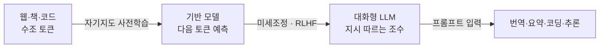

# Large Language Model - LLM (대규모 언어 모델)

> **대규모 언어 모델은 방대한 텍스트로 "다음에 올 단어 맞히기"를 학습한 초거대 신경망이며, 그 부산물로 번역·요약·코딩·추론 같은 능력이 딸려 나온 모델이다.**

## 초대형 자동완성이 지능처럼 보이기 시작한 것이다

스마트폰 키보드의 자동완성을 떠올려 보자. "오늘 날씨가 참" 다음에 "좋다"를 제안하는 그 기능이다. LLM은 원리상 이 자동완성과 똑같다. **주어진 앞 문맥 다음에 올 단어(정확히는 [토큰](Tokenization.md))의 확률을 예측하고, 확률이 높은 것을 골라 이어붙이는 일을 반복한다.**

차이는 규모다. 키보드 자동완성이 문장 몇 개를 봤다면, LLM은 인터넷 규모의 텍스트 수조 개 토큰을 봤고 파라미터가 수십억에서 수천억 개에 이른다. 그런데 이 "다음 단어 맞히기"를 극한까지 잘하려면 문법, 사실, 논리, 코드 구조, 심지어 번역 규칙까지 은연중에 익혀야 한다. **그래서 단순한 예측 과제 하나를 거대한 규모로 풀었더니, 명시적으로 가르치지 않은 능력들이 덤으로 나타났다.** 이것이 LLM이 놀라운 이유다.

## 트랜스포머 위에서 자기지도로 학습한다

LLM의 뼈대는 거의 예외 없이 [Transformer](Transformer.md)다. 문장 안 단어들이 서로를 참조하는 [Self-Attention](SelfAttention.md) 덕분에 긴 문맥을 병렬로 처리할 수 있어, GPU를 총동원한 초거대 학습이 가능해졌다.

학습은 사람이 정답을 붙이지 않는 [자기지도 학습](SelfSupervised_Learning.md)이다. 정답 레이블이 따로 없어도, "문장의 다음 토큰"이 곧 정답이 되기 때문에 날것의 텍스트만으로 무한히 학습할 수 있다.

현대 LLM은 대체로 두 단계를 거친다. 먼저 방대한 텍스트로 **사전학습(pretraining)**해 언어의 일반 능력을 갖춘 [기반 모델](Foundation_Model.md)을 만들고, 그다음 [Fine-tuning](Fine_Tuning.md)과 [RLHF](RLHF.md)로 "사람의 지시를 공손하고 유용하게 따르도록" 다듬는다. 우리가 챗봇으로 만나는 것은 이 다듬어진 버전이다.

## 흔한 오해

> ⚠️ **흔한 오해 — "LLM은 답을 데이터베이스에서 찾아 꺼내온다."**
>
> LLM은 사실을 저장한 검색 엔진이 아니다. 학습 때 본 패턴을 파라미터에 압축해 두었다가, 그 통계에 기반해 그럴듯한 다음 토큰을 **생성**할 뿐이다. 그래서 근거가 없어도 자신 있게 틀린 말을 지어내는 [환각](Hallucination.md)이 구조적으로 발생한다. 최신 사실이나 사내 문서가 필요하면 [RAG](Retrieval_Augmented_Generation___RAG.md)로 외부 지식을 붙여줘야 한다.

> 💡 **참고 — "크게 만들수록 좋아진다"에는 규칙이 있다.**
> 모델 크기·데이터량·연산량을 함께 키우면 성능이 매끄럽게 향상된다는 경험 법칙을 **스케일링 법칙(scaling law)**이라 부른다. 2020년대 초거대 모델 경쟁은 이 법칙에 대한 믿음에서 출발했다.

## LLM을 실제로 쓰는 세 가지 층위

같은 모델이라도 목적에 맞게 다루는 방법이 다르다. 비용과 손이 적게 드는 순서로 정리하면 이렇다.

| 방법 | 무엇을 하나 | 언제 |
|------|------------|------|
| [프롬프트 엔지니어링](Prompt_Engineering.md) | 입력 문장만 잘 설계 | 가장 빠르고 싸다. 대부분 여기서 시작 |
| [RAG](Retrieval_Augmented_Generation___RAG.md) | 외부 문서를 찾아 프롬프트에 끼워줌 | 최신·전용 지식이 필요할 때 |
| [미세조정](Fine_Tuning.md) / [LoRA](LoRA.md) | 모델 가중치 자체를 조정 | 말투·형식·전문 영역을 몸에 배게 할 때 |

## 정리하면

- LLM은 **트랜스포머 기반의 초거대 신경망**이며, 핵심 학습 과제는 "다음 토큰 예측"이다.
- 규모를 키우자 번역·요약·추론 같은 능력이 **가르치지 않았는데도 창발**했다.
- 사전학습으로 기반 능력을 얻고, 미세조정·RLHF로 사람 지시를 따르도록 정렬된다.
- 사실을 검색하는 게 아니라 생성하므로 [환각](Hallucination.md)의 위험을 늘 안고 있다.

## 함께 읽기

- [Foundation Model](Foundation_Model.md) — LLM은 텍스트 영역의 대표적 기반 모델이다.
- [Transformer](Transformer.md) — 모든 현대 LLM의 뼈대가 되는 구조.
- [GPT](GPT.md) — 다음 토큰 예측형 LLM의 대표 계열.
- [RLHF](RLHF.md) — 날것의 LLM을 사람 지시를 따르는 조수로 바꾸는 과정.
- [Hallucination](Hallucination.md) — LLM이 사실을 생성할 때 생기는 구조적 약점.
