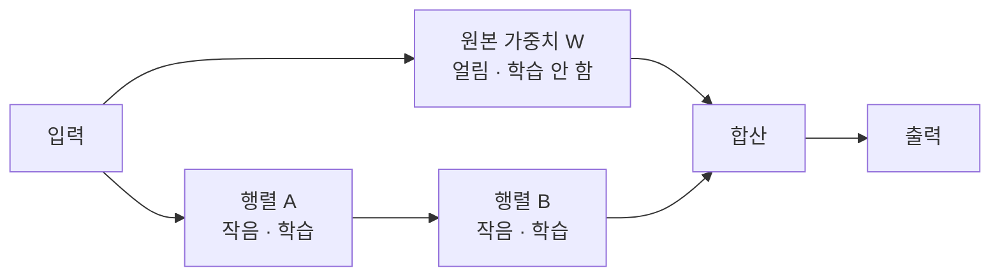

# LoRA (저차원 적응)

> **LoRA는 거대 모델의 원래 가중치는 얼려둔 채, 각 층에 작은 저차원 행렬 한 쌍만 추가로 학습해 값싸고 가볍게 미세조정하는 기법이다.**

## 두꺼운 원본 문서에 얇은 수정 메모지만 덧붙이는 것이다

수백 쪽짜리 계약서 원본을 통째로 다시 인쇄하는 대신, **바뀌는 부분만 얇은 수정 메모지에 적어 원본에 끼워 넣는다고 상상해 보자.** 원본은 그대로 두고 메모지만 갈아 끼우면 여러 버전을 값싸게 관리할 수 있다. LoRA가 정확히 이 방식이다. 수십억 개 가중치를 가진 [기반 모델](Foundation_Model.md)을 통째로 갱신하는 대신, 층마다 아주 작은 "수정 메모지"만 학습한다.

전체 [미세조정](Fine_Tuning.md)의 문제는 명백하다. 파라미터가 수십억 개면 갱신에도, 저장에도 막대한 비용이 든다. 과제가 열 개면 거대 모델 사본이 열 개 필요하다. **LoRA는 이 부담을 수백~수천 배 줄인다.** LoRA는 효율적 미세조정(PEFT)의 대표 기법이다.

## 가중치 변화량을 두 개의 작은 행렬 곱으로 근사한다

핵심 아이디어는 "미세조정으로 생기는 가중치 변화량 `ΔW`가 사실 저차원(low-rank)으로 충분히 표현된다"는 관찰이다. 그래서 `ΔW`를 통째로 학습하지 않고, 훨씬 작은 두 행렬 `A`와 `B`의 곱으로 근사한다.

```
W_new = W + ΔW ≈ W + B·A
```

- `W`: 원래 가중치. **학습 중 얼려둔다(갱신 안 함).**
- `A`, `B`: 새로 추가하는 작은 행렬. **이것만 학습한다.**
- `r`: A와 B의 크기를 정하는 **rank**. 작을수록 파라미터가 적다.



예를 들어 `1000 x 1000` 가중치는 백만 개 값을 갖지만, rank를 8로 잡으면 `A`는 `8 x 1000`, `B`는 `1000 x 8`으로 합쳐 1만 6천 개뿐이다. **학습·저장할 파라미터가 백만에서 1만 6천으로 줄어든다.** 추론 시에는 `B·A`를 원본에 더해 합칠 수 있어 속도 손실도 거의 없다.

## 흔한 오해

> ⚠️ **흔한 오해 — "LoRA는 원본 모델을 영구히 바꾼다."**
>
> 원본 가중치 `W`는 손대지 않는다. LoRA가 학습하는 것은 작은 어댑터(`A`, `B`)뿐이라, 이 어댑터만 갈아 끼우면 하나의 원본 모델로 여러 과제를 오간다. 고객사별·말투별 어댑터를 따로 저장했다가 필요할 때 붙이는 식으로 쓴다.

> 💡 **참고 — QLoRA는 여기서 한 걸음 더 나간다.**
> 원본 모델을 4비트로 [양자화](Model_Quantization.md)해 메모리를 더 줄인 상태에서 LoRA를 얹는 **QLoRA** 덕분에, 거대 모델도 GPU 한 장에서 미세조정할 수 있게 됐다.

## 정리하면

- LoRA는 **원본 가중치를 얼리고 작은 저차원 행렬 쌍만 학습**하는 효율적 미세조정이다.
- 핵심 가정은 "미세조정의 가중치 변화량은 저차원으로 충분하다"이다.
- 학습·저장 비용을 수백~수천 배 줄이고, 어댑터만 교체해 여러 과제를 오간다.
- 양자화와 결합한 QLoRA로 거대 모델도 값싸게 조정할 수 있다.

## 함께 읽기

- [Fine-tuning](Fine_Tuning.md) — LoRA가 값싸게 대체하려는 상위 개념.
- [Foundation Model](Foundation_Model.md) — LoRA로 적응시키는 거대한 원본 모델.
- [Model Quantization](Model_Quantization.md) — QLoRA에서 메모리를 더 줄이는 데 결합되는 기법.
- [Large Language Model - LLM](Large_Language_Model___LLM.md) — LoRA가 가장 활발히 쓰이는 무대.
