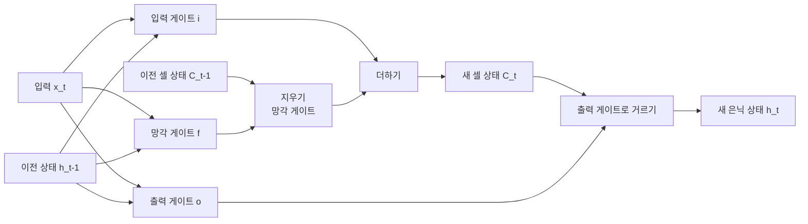

# Long Short-Term Memory – LSTM (장단기 메모리)

> **LSTM은 셀 상태라는 별도의 기억 통로와 세 개의 게이트를 두어, 기본 RNN이 놓치던 긴 의존성을 학습하는 순환 신경망이다.**

## 컨베이어벨트 위에 기억을 실어 멀리 나른다

기본 [RNN](Recurrent_Neural_Network___RNN.md)은 문장이 길어지면 앞쪽 정보를 금방 잊는다. 매 시점 은닉 상태를 곱셈으로 갱신하다 보니, 기울기가 반복적으로 곱해지며 0으로 사라지는 **기울기 소실(vanishing gradient)** 때문이다. "나는 프랑스에서 자랐다 ... 그래서 나는 ___를 유창하게 한다"에서 빈칸이 '프랑스어'임을 알려면 멀리 떨어진 단어를 기억해야 하는데, RNN은 그 거리를 못 버틴다.

LSTM의 해법은 **셀 상태(cell state)라는 별도의 컨베이어벨트**다. 이 벨트는 시점을 가로질러 거의 그대로 흐르고, 게이트들이 그 위에 정보를 조금씩 내려놓거나 걷어낸다. 곱셈 대신 덧셈으로 기억을 이어 가므로 정보가 멀리까지 살아남는다.

## 세 개의 게이트가 셀 상태를 지운다·더한다·내보낸다

LSTM 셀은 시점마다 셀 상태 `C`와 은닉 상태 `h`를 함께 나른다. 세 게이트가 셀 상태를 관리한다.

- **망각 게이트(forget gate)** — 이전 셀 상태에서 **무엇을 지울지** 정한다.
- **입력 게이트(input gate)** — 새 후보 정보 중 **무엇을 셀에 더할지** 정한다.
- **출력 게이트(output gate)** — 갱신된 셀 상태에서 **무엇을 이번 은닉 상태로 내보낼지** 정한다.

핵심은 **셀 상태가 게이트로 조절되는 덧셈 경로로 흐른다**는 점이다. 이 구조 덕분에 기울기가 멀리까지 전달돼, 수십~수백 시점 떨어진 의존성도 학습할 수 있다.

## 흔한 오해

> ⚠️ **흔한 오해 — "LSTM은 기울기 소실을 완전히 없앤다."**
>
> LSTM은 소실을 크게 **완화**할 뿐 없애지는 못한다. 시퀀스가 극단적으로 길면 여전히 한계가 있다. 아주 긴 문맥이나 대규모 병렬 학습이 필요한 오늘날의 언어 모델은 순환 구조 대신 [트랜스포머](Transformer.md)의 [셀프 어텐션](SelfAttention.md)을 쓰는 쪽으로 옮겨 갔다.

## 정리하면

- LSTM은 **셀 상태라는 별도 기억 통로**로 긴 의존성 문제를 푼다.
- 망각·입력·출력 **세 게이트**가 셀 상태를 지우고·더하고·내보낸다.
- 곱셈이 아닌 **덧셈 경로**로 정보를 이어가 기울기 소실을 완화한다.
- 소실을 없애지는 못하며, 초장문·대규모 병렬에서는 트랜스포머에 자리를 내줬다.

## 함께 읽기

- [Recurrent Neural Network – RNN](Recurrent_Neural_Network___RNN.md) — LSTM이 개선한 기본 순환 신경망과 기울기 소실 문제.
- [GRU](GRU.md) — 게이트를 둘로 줄인 LSTM의 경량 사촌.
- [Transformer](Transformer.md) — 순환 없이 어텐션으로 긴 의존성을 다루는 후계 구조.
- [Gradient Descent](Gradient_Descent.md) — 기울기 소실이 왜 학습을 막는지 이해하는 바탕.
