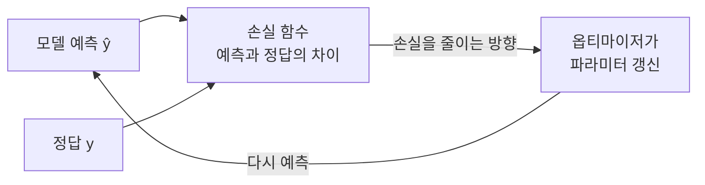

# Loss Function (손실 함수)

> **손실 함수는 모델의 예측이 정답에서 얼마나 벗어났는지를 하나의 숫자로 재는 함수이며, 학습이란 이 숫자를 줄여가는 과정이다.**

## 과녁에서 얼마나 빗나갔는지 재는 자와 같다

활을 쏠 때 화살이 과녁 중앙에서 얼마나 벗어났는지 알아야 다음 발을 교정할 수 있다. **손실 함수가 바로 이 "빗나간 거리"를 재는 자다.** 모델이 예측을 내놓으면, 손실 함수는 그것이 정답과 얼마나 다른지를 숫자로 매긴다. 이 숫자가 클수록 예측이 나쁜 것이고, 학습의 목표는 이 손실을 **최대한 작게** 만드는 것이다.

손실이 학습의 나침반인 이유가 여기 있다. [옵티마이저](Optimizer.md)는 손실 함수의 [기울기](Gradient_Descent.md)를 보고, 손실이 줄어드는 방향으로 파라미터를 조금씩 움직인다. **줄일 대상(손실)을 어떻게 정의하느냐가 모델이 무엇을 잘하게 될지를 결정한다.**

## 문제 종류마다 맞는 손실이 다르다

손실 함수는 아무거나 쓰는 게 아니라 **문제 유형에 맞춰** 고른다.

| 문제 유형 | 대표 손실 함수 | 무엇을 재나 |
|-----------|----------------|-------------|
| 회귀(연속값 예측) | [평균 제곱 오차(MSE)](Mean_Squared_Error.md) | 예측값과 실제값 차이의 제곱 평균 |
| 회귀(이상치에 덜 민감) | 평균 절대 오차(MAE) | 차이의 절댓값 평균 |
| 이진 분류 | 이진 교차 엔트로피 | 예측 확률이 정답 확률과 얼마나 다른지 |
| 다중 분류 | [교차 엔트로피](CrossEntropy.md) | 정답 클래스에 얼마나 높은 확률을 줬는지 |

분류에서 "정확도" 대신 [교차 엔트로피](CrossEntropy.md) 같은 확률 기반 손실을 쓰는 이유는, 정확도는 계단처럼 뚝뚝 끊겨 기울기가 거의 0이라 학습 신호를 못 주기 때문이다. 손실 함수는 **매끄럽게 미분 가능**해야 경사 하강법이 작동한다.

## 흔한 오해

> ⚠️ **흔한 오해 — "손실 함수와 평가 지표는 같은 것이다."**
>
> 둘은 다르다. 손실 함수는 **학습 중에 최소화하는 대상**이라 미분 가능해야 하고, 평가 지표([정확도](Precision.md)·[F1](F1_Score.md) 등)는 **사람이 성능을 해석하려고 보는 값**이라 미분 가능할 필요가 없다. 분류 모델은 교차 엔트로피로 학습하고 정확도로 평가하는 식으로, 둘을 다르게 쓰는 경우가 흔하다.

> 💡 **참고 — 손실(loss)과 비용(cost)은 거의 같은 뜻으로 쓰인다.**
>
> 엄밀히는 손실을 표본 하나에 대한 오차, 비용(cost function)을 전체(또는 배치) 평균으로 구분하기도 하지만, 실무에서는 구분 없이 섞어 쓰는 경우가 많다.

## 정리하면

- 손실 함수는 예측이 정답에서 벗어난 정도를 **한 숫자로 재는 자**이고, 학습은 이 숫자를 줄이는 것이다.
- [옵티마이저](Optimizer.md)는 손실의 기울기를 따라 파라미터를 갱신하므로, 손실은 미분 가능해야 한다.
- 회귀에는 [MSE](Mean_Squared_Error.md), 분류에는 [교차 엔트로피](CrossEntropy.md)처럼 **문제에 맞는 손실**을 고른다.
- 학습에 쓰는 손실과 결과 해석에 쓰는 평가 지표는 다를 수 있다.

## 함께 읽기

- [Mean Squared Error](Mean_Squared_Error.md) — 회귀에서 가장 흔한 손실 함수.
- [Cross-Entropy](CrossEntropy.md) — 분류에서 표준으로 쓰는 손실 함수.
- [Optimizer](Optimizer.md) — 손실을 줄이는 방향으로 파라미터를 움직이는 주체.
- [Gradient Descent](Gradient_Descent.md) — 손실의 기울기를 따라 내려가는 최적화 원리.
