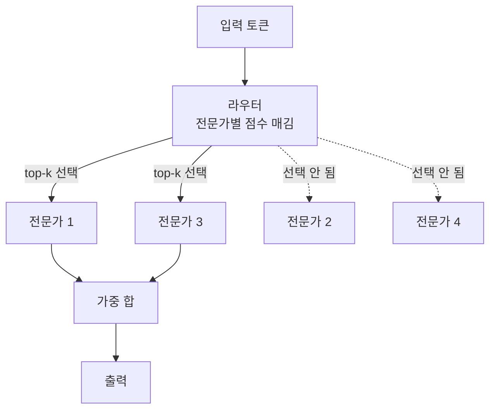

# Mixture of Experts - MoE (전문가 혼합)

> **전문가 혼합은 여러 개의 전문가 신경망을 두고, 입력마다 그중 일부만 골라 쓰는 구조로, 모델을 거대하게 키우면서도 계산량은 낮게 유지하는 기법이다.**

## 모든 의사가 아니라 필요한 전문의만 부른다

큰 병원에 들어온 환자를 모든 의사가 한꺼번에 진료하지는 않는다. 접수처(라우터)가 증상을 보고 **관련 있는 전문의 한두 명에게만** 보낸다. 심장 환자는 심장내과로, 골절 환자는 정형외과로. **전문가 혼합이 바로 이 방식이다.** 모델 안에 수많은 전문가(작은 신경망)를 두되, 입력 하나를 처리할 때는 라우터가 고른 소수의 전문가만 깨워 쓴다.

이렇게 하면 이상한 이점이 생긴다. **모델이 가진 전체 파라미터는 어마어마하게 많지만, 토큰 하나를 처리하는 데 실제로 쓰는 파라미터는 그중 일부뿐**이다. 지식은 방대하게 담되 계산 비용은 작게 유지하는 것, 이것이 MoE의 존재 이유다.

## 라우터가 상위 k개 전문가만 켜는 희소 활성화

MoE 층은 두 부품으로 이뤄진다.

- **전문가(experts)** — 각각 독립적인 작은 신경망(보통 [트랜스포머](Transformer.md)의 피드포워드 블록). 학습을 거치며 서로 다른 패턴에 특화된다.
- **라우터/게이팅(router)** — 입력 토큰을 보고 어떤 전문가에게 보낼지 점수를 매겨, **상위 k개(보통 1~2개)**만 선택한다.

선택된 전문가만 계산에 참여하므로 이를 **희소 활성화(sparse activation)**라 부른다. 전체를 다 쓰는 밀집(dense) 모델과 대비된다.

한 가지 골칫거리는 **부하 불균형**이다. 방치하면 라우터가 몇몇 인기 전문가에게만 몰려, 나머지는 놀고 소수만 과로한다. 그래서 전문가마다 일감이 고루 퍼지도록 유도하는 **부하 분산 손실(load balancing loss)**을 함께 학습시킨다.

## 흔한 오해

> ⚠️ **흔한 오해 — "전문가마다 '수학 담당', '번역 담당'처럼 사람이 알아볼 역할이 정해진다."**
>
> 전문가의 특화는 학습으로 저절로 갈리는 것이라, 대개 사람이 이름 붙일 만한 깔끔한 역할과 일치하지 않는다. 라우팅은 토큰 단위로 일어나며 그 기준은 대체로 해석하기 어렵다.

## 왜 쓰나 — 장단점

| 장점 | 단점 |
|------|------|
| 전체 파라미터(지식 용량)를 크게 키워도 토큰당 계산량은 낮게 유지 | 파라미터가 전부 메모리에 올라가야 해 VRAM 요구가 크다 |
| 같은 계산 예산에서 밀집 모델보다 높은 성능을 노릴 수 있다 | 라우팅·부하 분산 때문에 학습이 까다롭고 불안정할 수 있다 |
| 전문가를 늘려 확장하기 쉽다 | 배치 내 토큰마다 다른 전문가로 흩어져 서빙 최적화가 복잡 |

Mixtral, Switch Transformer, GShard 같은 모델이 대표적인 MoE 구현이다.

## 정리하면

- MoE는 여러 전문가 중 **라우터가 고른 소수만 켜는(희소 활성화)** 구조다.
- 덕분에 **전체 파라미터는 크게, 토큰당 계산은 작게** 가져간다.
- 전문가·라우터·부하 분산 손실이 핵심 부품이다.
- 지식 용량을 늘리는 값은 큰 메모리와 까다로운 학습·서빙으로 치른다.

## 함께 읽기

- [Transformer](Transformer.md) — MoE 층이 대개 트랜스포머의 피드포워드 블록을 대체하며 들어간다.
- [Large Language Model - LLM](Large_Language_Model___LLM.md) — 거대 언어 모델을 효율적으로 키우려고 MoE를 채택하는 흐름.
- [Neural Network](Neural_Network.md) — 전문가 하나하나가 결국 작은 신경망이다.
