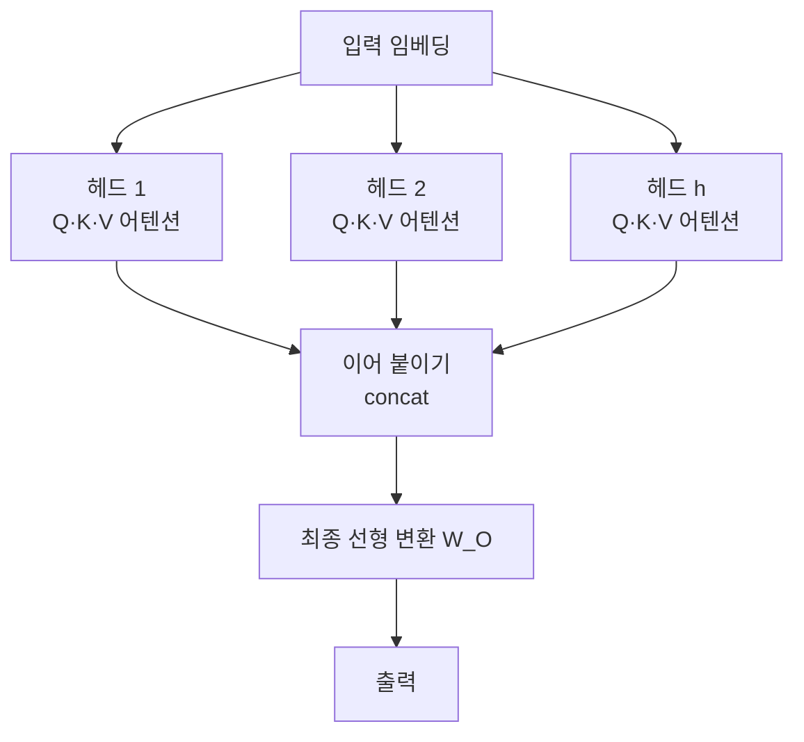

# Multi-Head Attention (다중 헤드 어텐션)

> **다중 헤드 어텐션은 하나의 어텐션을 여러 개의 독립된 헤드로 나눠 병렬로 수행한 뒤 합치는 기법으로, 단어 사이의 관계를 여러 관점에서 동시에 포착한다.**

## 한 문장을 여러 전문가가 각자의 눈으로 읽는다

[셀프 어텐션](SelfAttention.md) 하나만 쓰면 단어들 사이의 관계를 **한 가지 방식으로만** 본다. 그런데 언어의 관계는 다층적이다. "그 은행 앞 강가에서"라는 구절에서 어떤 관점은 '은행-강가'의 문법적 수식 관계를, 다른 관점은 '은행'이 금융기관이 아니라 강둑이라는 의미적 단서를 봐야 한다.

다중 헤드 어텐션은 이 문제를 **여러 전문가에게 같은 문장을 동시에 읽히는 것**으로 푼다. 각 헤드는 서로 다른 부분공간에서 어텐션을 계산하므로, 하나는 가까운 어순 관계에, 다른 하나는 먼 의미 관계에 주목하는 식으로 역할을 나눠 학습한다.

## 나누고, 각자 어텐션하고, 이어 붙인다

입력 임베딩을 헤드 수 `h`만큼 나눠 처리한다. 각 헤드는 자기만의 가중치로 Query·Key·Value를 만든다.

1. **헤드별 선형 투영** — 입력을 헤드마다 다른 가중치 `W_Q, W_K, W_V`로 곱해 헤드 고유의 Q·K·V를 만든다.
2. **헤드별 어텐션** — 각 헤드가 독립적으로 스케일드 닷프로덕트 어텐션을 계산한다: `softmax(Q·Kᵀ / √d_k)·V`. `√d_k`로 나누는 스케일링은 내적이 커져 소프트맥스가 포화되는 것을 막는다.
3. **이어 붙이기(concat)** — 모든 헤드의 출력 벡터를 옆으로 이어 붙인다.
4. **최종 선형 변환** — 이어 붙인 결과를 가중치 `W_O`로 한 번 더 투영해 최종 출력을 만든다.

> 💡 **참고 — 왜 나눠도 비용이 안 늘까**
>
> 각 헤드의 차원을 `전체차원 / h`로 잡기 때문에, 헤드를 여러 개 둬도 전체 연산량은 헤드 하나로 크게 계산할 때와 비슷하다. 표현의 다양성은 얻으면서 비용은 그대로인 셈이다.

## 흔한 오해

> ⚠️ **흔한 오해 — "헤드가 많을수록 성능이 계속 좋아진다."**
>
> 헤드 수는 하이퍼파라미터일 뿐 무작정 늘린다고 좋아지지 않는다. 연구에 따르면 학습된 헤드 상당수는 중복되어 **잘라내도 성능이 거의 유지되는** 경우가 많다. 적정 개수는 과제와 모델 크기에 따라 실험으로 정한다.

## 정리하면

- 다중 헤드 어텐션은 어텐션을 **여러 독립 헤드로 병렬 수행**한 뒤 합친다.
- 각 헤드가 서로 다른 부분공간을 봐서 **여러 관점의 관계**를 동시에 학습한다.
- 나누기 → 헤드별 어텐션 → 이어 붙이기 → 최종 투영 순서로 동작한다.
- 헤드 차원을 나눠 잡아 연산량은 유지되며, 헤드는 많다고 늘 좋은 것이 아니다.

## 함께 읽기

- [Self-Attention](SelfAttention.md) — 각 헤드가 수행하는 단일 어텐션의 원리.
- [Attention](Attention.md) — Q·K·V와 어텐션 가중치의 가장 기본 개념.
- [Transformer](Transformer.md) — 다중 헤드 어텐션을 핵심 블록으로 쓰는 아키텍처.
- [Softmax](Softmax.md) — 어텐션 가중치를 확률처럼 정규화하는 함수.
