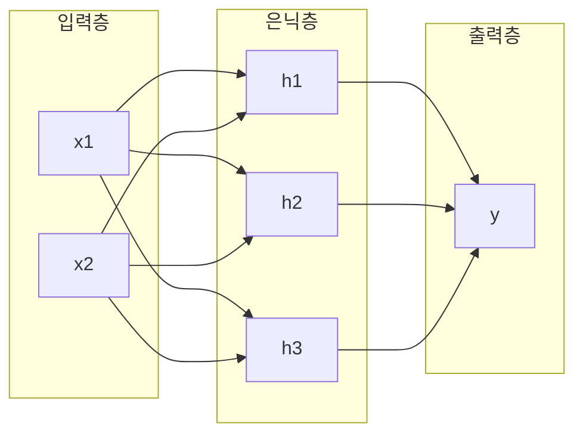

# Multilayer Perceptron (다층 퍼셉트론)

> **다층 퍼셉트론은 뉴런의 층을 여러 겹 쌓고 그 사이에 비선형 활성화를 넣어, 직선으로는 못 가르는 복잡한 패턴까지 학습하는 기본 신경망이다.**

## 퍼셉트론 한 장으로는 못 긋는 경계를 층을 쌓아 긋는다

단층 [퍼셉트론](Perceptron.md)은 데이터를 하나의 직선(초평면)으로만 가른다. 그래서 XOR처럼 직선 하나로 나뉘지 않는 문제 앞에서는 무력하다. **다층 퍼셉트론(MLP)은 여기에 은닉층을 끼워 넣어 이 한계를 넘는다.**

비유하자면 종이를 한 번 접으면 직선만 만들 수 있지만, 여러 번 접으면 복잡한 모양을 오려낼 수 있는 것과 같다. 은닉층 하나하나가 입력 공간을 접고 휘어, 마지막 층에서는 얽힌 데이터도 깔끔히 갈라낼 수 있게 된다. 이 "접기"를 가능하게 하는 것이 바로 층 사이의 **비선형 활성화 함수**다.

## 입력층·은닉층·출력층이 완전연결로 이어진다

MLP는 입력층, 하나 이상의 은닉층, 출력층으로 이뤄지고, 이웃한 층의 모든 뉴런이 서로 연결된다(완전연결, fully connected).

각 뉴런은 **입력에 가중치를 곱해 더하고, 편향을 얹은 뒤, 활성화 함수를 통과**시킨다: `a = f(w·x + b)`. 학습은 두 방향으로 흐른다.

1. **순전파(forward)** — 입력이 층을 지나 출력(예측)까지 흐른다.
2. **역전파([backpropagation](Backpropagation.md))** — 예측과 정답의 오차를 뒤로 흘려보내며 각 가중치를 [기울기 하강](Gradient_Descent.md)으로 조금씩 고친다.

> ⚠️ **흔한 오해 — "층만 여러 개면 다층 퍼셉트론이다."**
>
> 층을 쌓아도 **활성화 함수가 없으면(선형이면)** 여러 층이 하나의 선형 변환으로 뭉개져 단층과 다를 게 없어진다. 층을 쌓는 의미는 [ReLU](ReLU.md)·[시그모이드](Sigmoid.md) 같은 **비선형 활성화가 끼어들 때** 비로소 살아난다.

## 정리하면

- MLP는 입력·은닉·출력층을 **완전연결**로 쌓은 기본 신경망이다.
- 은닉층과 **비선형 활성화** 덕분에 직선으로 못 가르는 패턴도 학습한다.
- 순전파로 예측하고, 역전파와 기울기 하강으로 가중치를 갱신한다.
- 활성화가 없으면 층을 쌓아도 단층과 같아진다.

## 함께 읽기

- [Perceptron](Perceptron.md) — MLP의 뉴런 하나에 해당하는 단층 모델.
- [Neural Network](Neural_Network.md) — MLP를 포함하는 신경망의 큰 개념.
- [Backpropagation](Backpropagation.md) — MLP의 가중치를 학습시키는 핵심 알고리즘.
- [Activation Function](Activation_Function.md) — 층을 쌓는 의미를 만들어 주는 비선형 함수.
