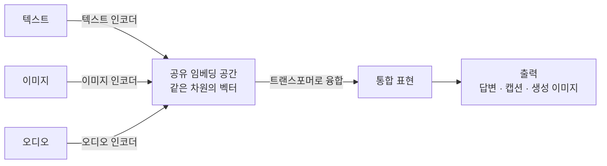

# Multimodal AI (멀티모달 AI)

> **멀티모달 AI는 텍스트·이미지·오디오·영상처럼 서로 다른 형태의 데이터를 한 모델이 함께 이해하고 다루는 AI다.**

## 눈·귀·입을 함께 쓰는 사람처럼

사람은 요리 영상을 볼 때 화면(시각)과 설명(언어)과 지글거리는 소리(청각)를 따로 처리하지 않고 **한꺼번에 엮어** 이해한다. "이 사진 속 사람이 왜 웃고 있어?"라는 질문에 답하려면 사진과 문장을 동시에 읽어야 한다. **멀티모달 AI가 지향하는 것이 바로 이 감각의 통합이다.** 텍스트만 다루던 모델(단일 모달)의 한 겹 벽을 허물고, 여러 종류의 입력을 하나의 흐름으로 소화한다.

여기서 **모달리티(modality)**란 데이터의 종류, 즉 정보가 담긴 형태를 뜻한다. 텍스트·이미지·음성·영상·표 등이 각각 하나의 모달리티다.

## 서로 다른 데이터를 하나의 벡터 공간으로 모은다

멀티모달 모델의 핵심 아이디어는 단순하다. **모달리티마다 전용 인코더로 특징을 뽑아, 모두 같은 [임베딩](Embedding.md) 공간의 벡터로 바꾼다.** 일단 같은 공간의 벡터가 되면, 이미지든 문장이든 모델 입장에서는 똑같은 숫자 뭉치라 함께 계산하고 비교할 수 있다.

이 융합의 중심에는 대부분 [트랜스포머](Transformer.md)와 [어텐션](Attention.md)이 있다. 어텐션은 "이 문장 단어가 이미지의 어느 영역과 관련 있나"처럼 **모달리티를 가로질러 연결**을 짓는 데 특히 잘 맞는다.

학습 방식으로 널리 쓰이는 것이 **대조 학습(contrastive learning)**이다. 예컨대 CLIP은 웹에서 모은 방대한 이미지-설명문 쌍을 놓고, 짝이 맞는 이미지와 문장의 벡터는 가깝게, 안 맞는 쌍은 멀게 당기며 학습한다. 그 결과 "고양이 사진"의 벡터와 "고양이"라는 문장의 벡터가 자연스레 이웃하게 된다.

## 흔한 오해

> ⚠️ **흔한 오해 — "텍스트도 되고 이미지도 되면 다 멀티모달이다."**
>
> 텍스트용 모델과 이미지용 모델을 따로 두고 결과만 이어 붙이는 것은 진정한 멀티모달이 아니다. 핵심은 **여러 모달리티를 하나의 표현 공간에서 함께 추론**해, 모달리티 사이의 관계까지 활용하는 데 있다.

## 무엇을 할 수 있나

| 과제 | 입력 → 출력 |
|------|------------|
| 이미지 캡셔닝 | 이미지 → 설명 문장 |
| 시각 질의응답 (VQA) | 이미지 + 질문 → 답 |
| 텍스트-이미지 생성 | 문장 → 이미지 ([확산 모델](Diffusion_Model.md)이 대표적) |
| 교차 검색 | 문장으로 이미지 찾기, 또는 그 반대 |

## 정리하면

- 멀티모달 AI는 **텍스트·이미지·오디오 등 여러 형태의 데이터를 한 모델이 함께** 다룬다.
- 비결은 모달리티마다 인코더로 특징을 뽑아 **공유 임베딩 공간의 벡터로 통일**하는 것.
- [트랜스포머]와 어텐션이 모달리티를 가로지르는 연결을 만들고, 대조 학습이 대표적 학습법이다.
- 캡셔닝·시각 질의응답·텍스트-이미지 생성 등 감각을 넘나드는 과제를 푼다.

## 함께 읽기

- [Embedding](Embedding.md) — 서로 다른 모달리티를 하나로 묶는 공유 표현 공간의 토대.
- [Transformer](Transformer.md) — 모달리티 융합의 중심이 되는 구조.
- [Attention](Attention.md) — 텍스트와 이미지를 가로질러 연결을 짓는 핵심 메커니즘.
- [Diffusion Model](Diffusion_Model.md) — 문장을 이미지로 바꾸는 멀티모달 생성의 대표 엔진.
