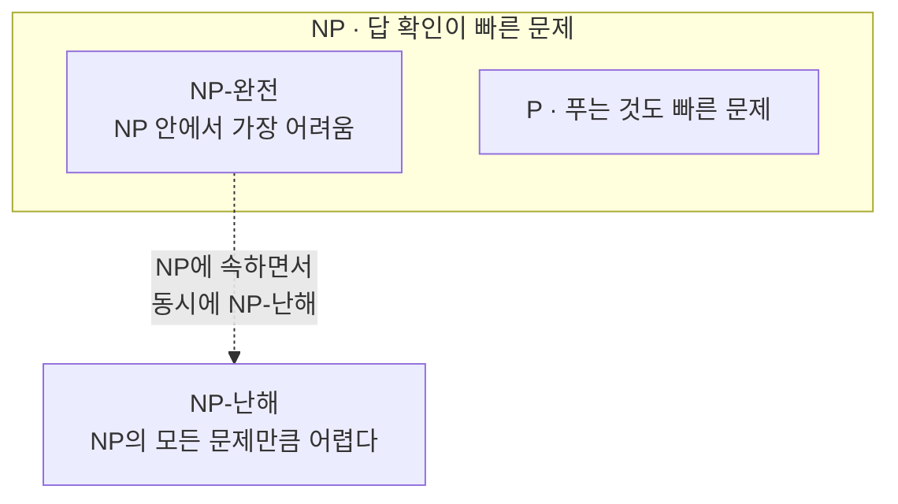

# NP-complete / NP-hard (NP-완전 / NP-난해)

> **NP-완전과 NP-난해는 "정답을 확인하긴 쉬운데 처음부터 찾기는 지독히 어려운" 문제들이 얼마나 어려운지를 가르는 계급장이다.**

## 스도쿠를 떠올리면 전부 잡힌다

다 푼 스도쿠가 맞는지 확인하는 건 몇 초면 된다. 각 줄·칸에 1~9가 겹치지 않는지 훑기만 하면 된다. 그런데 빈 칸투성이 스도쿠를 처음부터 푸는 건 훨씬 고되다. **"확인은 빠른데 푸는 건 느리다"** — 이 비대칭이 이 이야기의 전부다.

- **P** — 애초에 **빠르게(다항식 시간) 풀 수 있는** 문제들. 정렬, 최단경로 등.
- **NP** — 답을 주면 **빠르게 확인할 수 있는** 문제들. 스도쿠 검산이 빠른 게 이 경우다. (P는 NP에 포함된다. 풀 수 있으면 확인도 되니까.)

> 💡 **참고 — NP의 진짜 뜻**
>
> NP는 "Non-Polynomial(비다항식)"이 아니라 **Nondeterministic Polynomial time**의 약자다. "운 좋게 답을 찍었다면 다항식 시간에 검증된다"는 뜻이지, "느리다"는 뜻이 아니다. 흔한 오해다.

## NP-난해는 "적어도 그만큼 어렵다", NP-완전은 "그중에서도 대표선수"

두 계급장의 정의는 이렇게 갈린다.

| 구분 | 정의 | 한마디로 |
|------|------|----------|
| **NP-난해** | NP에 속한 **모든** 문제를 다항식 시간에 이 문제로 바꿔 풀 수 있다 | NP의 어떤 문제 못지않게 어렵다 |
| **NP-완전** | NP-난해이면서 **동시에 NP에도 속한다** | NP 안에서 가장 어려운 무리 |

핵심 관계는 이렇다. **NP-완전 = NP에 속함 + NP-난해.** 반면 NP-난해는 NP에 속하지 않아도 된다. 심지어 답을 확인하는 것조차 불가능한 문제도 NP-난해일 수 있다 — [멈춤 문제](Halting_Problem.md)가 그 예다. 즉 NP-난해가 NP-완전보다 넓은 개념이다.

대표적 NP-완전 문제로는 SAT(논리식 충족 가능성), 외판원 문제(판정형), [제약조건 만족 문제](Constraint_Satisfaction_Problem.md), 그래프 색칠 등이 있다.

## 흔한 오해

> ⚠️ **흔한 오해 — "NP-완전 문제는 지수 시간이 걸린다고 증명됐다."**
>
> 증명된 게 아니다. **P = NP 인지 P ≠ NP 인지는 아직 아무도 모르는 미해결 난제**다. 다만 지금껏 누구도 NP-완전 문제를 빠르게 푸는 법을 못 찾았을 뿐이다. 만약 NP-완전 문제 하나라도 다항식 시간에 풀리면, 그 순간 NP 전체가 무너지며 P = NP가 된다.

## 왜 알아야 하나

어떤 문제가 NP-완전 또는 NP-난해로 판명되면, **"완벽한 답을 빠르게 구하려는 시도"를 접고 다른 전략으로 갈아타야 한다는 신호**다. 그래서 현실에서는 최적해 대신 그럭저럭 좋은 답을 빠르게 내는 [휴리스틱](Heuristic.md), 근사 알고리즘, [최적화](Optimization.md) 기법으로 우회한다.

## 정리하면

- 공통 성질은 **"확인은 빠른데 푸는 건 느린"** 비대칭이다.
- **NP-완전 = NP에 속함 + NP-난해**, NP-난해는 NP에 안 속해도 되는 더 넓은 개념이다.
- 지수 시간이 필요하다고 증명된 게 아니라, **P vs NP는 여전히 미해결**이다.
- 이런 문제를 만나면 완벽한 답 대신 휴리스틱·근사로 우회한다.

## 함께 읽기

- [Halting Problem](Halting_Problem.md) — NP-난해이지만 아예 풀 수 없는 문제. 난이도의 다른 극단.
- [Heuristic](Heuristic.md) — 최적해를 포기하고 좋은 답을 빠르게 얻는 현실적 우회로.
- [Optimization](Optimization.md) — 이런 어려운 문제에서 최선의 답을 찾는 기법.
- [Constraint Satisfaction Problem](Constraint_Satisfaction_Problem.md) — 대표적인 NP-완전 문제군.
