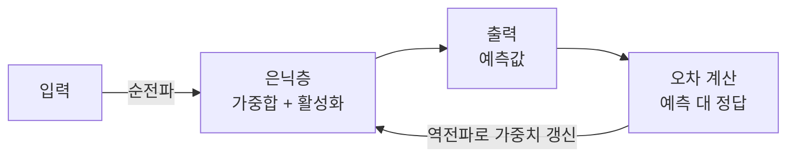

# Neural Network (신경망)

> **신경망은 단순한 뉴런들을 층으로 연결하고, 데이터로부터 그 연결 강도를 학습해 복잡한 패턴을 근사하는 계산 모델이다.**

## 단순한 스위치 수천 개가 모여 판단을 만든다

뉴런 하나가 하는 일은 우습도록 단순하다. **여러 입력에 저마다의 가중치를 곱해 더하고, 그 합을 활성화 함수에 통과시켜 하나의 숫자를 내보낸다.** 스위치 하나로는 아무것도 못 하지만, 이런 스위치를 수천·수만 개 층층이 엮으면 고양이 사진을 알아보고 언어를 번역하는 능력이 나온다. 각각은 멍청하지만 연결이 똑똑함을 만든다.

신경망이라는 이름은 뇌의 뉴런에서 영감을 받았지만, 실제 생물학적 뉴런과는 크게 다르다. **실제로는 가중치를 곱하고 더하는 행렬 연산의 연쇄일 뿐이다.** 뇌를 흉내 낸다는 표현은 비유로만 받아들이는 편이 정확하다.

## 층을 지나며 계산하고, 오차를 되돌려 학습한다

신경망은 입력층·은닉층·출력층으로 이뤄진다. 학습은 두 흐름의 반복이다.

- **순전파(forward)** — 입력이 층을 통과하며 각 뉴런에서 `가중합 → 활성화`를 거쳐 예측값에 이른다.
- **오차 계산** — 예측과 정답의 차이를 [손실 함수](Loss_Function.md)로 잰다.
- **역전파(backward)** — 오차를 뒤로 흘려보내 각 가중치가 오차에 얼마나 기여했는지 구하고, [기울기 하강](Gradient_Descent.md)으로 조금씩 고친다.

이 과정을 데이터 전체에 걸쳐 반복하면 가중치가 점점 좋은 값으로 자리 잡는다. **핵심은 비선형 활성화 함수다** — 이것이 없으면 층을 아무리 쌓아도 하나의 선형 변환에 불과해 복잡한 패턴을 담지 못한다.

## 흔한 오해

> ⚠️ **흔한 오해 — "층을 깊게 쌓기만 하면 성능이 좋아진다."**
>
> 무작정 깊게 쌓으면 기울기가 사라지거나 폭발하고, 데이터가 부족하면 [과적합](Overfitting.md)이 심해진다. 깊이의 이점은 [배치 정규화](Batch_Normalization.md)·잔차 연결·[드롭아웃](Dropout.md) 같은 장치와 충분한 데이터가 받쳐 줄 때 살아난다.

## 정리하면

- 신경망은 **단순한 뉴런을 층으로 엮어** 복잡한 패턴을 학습하는 모델이다.
- 뉴런은 `가중합 → 활성화`만 하며, 학습되는 것은 **연결의 가중치**다.
- 순전파로 예측하고 역전파로 오차를 되돌려 가중치를 갱신한다.
- **비선형 활성화**가 있어야 층을 쌓는 의미가 생긴다.

## 함께 읽기

- [Perceptron](Perceptron.md) — 신경망의 가장 단순한 원형인 뉴런 하나.
- [Multilayer Perceptron](Multilayer_Perceptron.md) — 층을 쌓은 가장 기본적인 신경망 형태.
- [Backpropagation](Backpropagation.md) — 가중치를 학습시키는 핵심 알고리즘.
- [Activation Function](Activation_Function.md) — 신경망에 비선형성을 넣는 함수.
- [Deep Learning](Deep_Learning.md) — 신경망을 깊게 쌓아 학습하는 분야.
