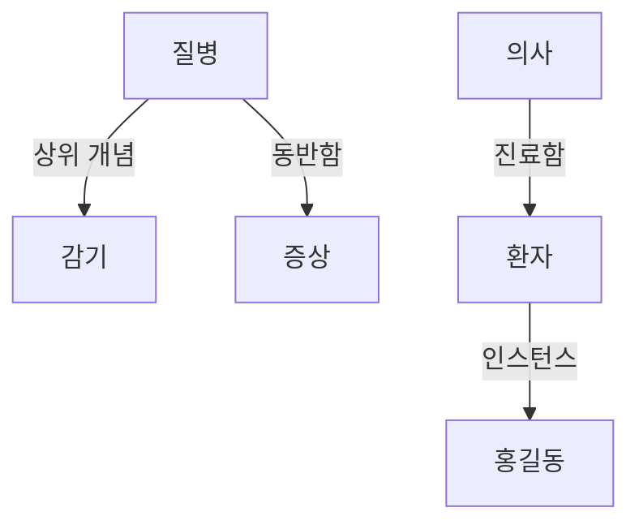

# Ontology (온톨로지)

> **온톨로지는 어떤 분야의 개념들과 그 사이의 관계를 컴퓨터가 이해하고 추론할 수 있게 명시적으로 정의해 둔 지식의 설계도다.**

## 사전과 가계도를 합친 것에 가깝다

사람은 "감기는 질병이고, 질병은 증상을 동반하며, 의사는 환자를 진료한다"를 상식으로 안다. 하지만 컴퓨터에게 "감기"는 그냥 두 글자일 뿐, 그게 질병인지 음식인지 모른다. 온톨로지는 이 상식을 **기계가 읽을 수 있는 형태로 못 박아 두는 것**이다.

사전이 낱말의 뜻을 정의한다면, 온톨로지는 거기에 더해 **개념들이 서로 어떻게 얽혀 있는지**까지 담는다. 그래서 사전과 가계도를 합친 모양에 가깝다.

- **클래스(class·개념)** — 개념의 종류. 예: `질병`, `의사`, `환자`.
- **인스턴스(instance)** — 클래스의 구체적 사례. 예: `홍길동`은 `환자`의 인스턴스.
- **속성(property·attribute)** — 개념이 가진 특징. 예: 환자의 `나이`.
- **관계(relation)** — 개념들을 잇는 연결. 예: `의사 —진료함→ 환자`.
- **공리(axiom)** — 항상 참으로 두는 규칙. 예: "모든 감기는 질병이다."

## 관계를 그래프로 엮어 두면 새 사실을 추론할 수 있다

온톨로지는 개념을 노드로, 관계를 엣지로 하는 그래프 구조로 표현된다. 여기에 **상속(is-a)** 관계를 넣으면 힘이 커진다.

"감기는 질병이다"와 "모든 질병은 증상을 동반한다"를 정의해 두면, [추론 엔진](Inference_Engine.md)이 **명시하지 않은 사실 — "감기도 증상을 동반한다" — 을 스스로 끌어낸다.** 이것이 온톨로지가 단순 데이터베이스와 다른 지점이다. 데이터를 저장할 뿐 아니라 그 위에서 추론이 돈다.

웹에서는 RDF·OWL 같은 표준 언어로 온톨로지를 기술해, 서로 다른 시스템이 같은 의미로 데이터를 주고받게 한다. 이것이 [의미웹](Semantic_Web.md)의 뼈대다.

## 흔한 오해

> ⚠️ **흔한 오해 — "온톨로지는 그냥 데이터베이스 스키마 아닌가?"**
>
> 겹치는 면은 있지만 목적이 다르다. 스키마는 "데이터를 어떤 표에 어떻게 담을지"를 정하고, 온톨로지는 "개념들이 무슨 의미이고 어떻게 얽혀 있는지"를 정해 **추론까지 가능하게** 한다. 스키마는 저장 구조, 온톨로지는 의미 구조다.

## 정리하면

- 온톨로지는 한 분야의 **개념·속성·관계·규칙을 기계가 읽을 수 있게 정의한 지식의 설계도**다.
- 클래스·인스턴스·관계·공리로 이뤄지고, 상속 관계 덕분에 추론이 가능하다.
- 명시하지 않은 사실을 끌어낸다는 점에서 단순 저장소와 다르다.
- 의미웹·지식 관리·의료 정보 시스템 등에서 서로 다른 시스템의 의미를 맞추는 데 쓰인다.

## 함께 읽기

- [Semantic Web](Semantic_Web.md) — 온톨로지를 뼈대로 웹의 정보에 의미를 부여하려는 시도.
- [Semantic Network](Semantic_Network.md) — 개념을 노드·관계로 잇는, 온톨로지와 가까운 지식 표현.
- [Knowledge Engineering](Knowledge_Engineering.md) — 이런 지식 구조를 설계하고 구축하는 분야.
- [Inference Engine](Inference_Engine.md) — 온톨로지 위에서 새 사실을 추론하는 엔진.
