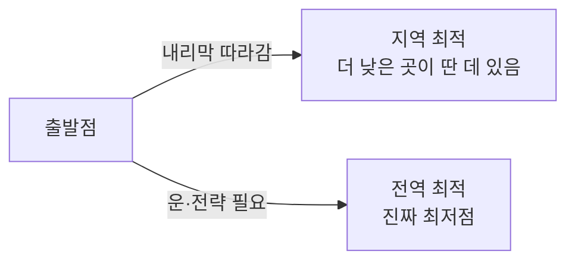

# Optimization (최적화)

> **최적화는 정해진 조건 안에서 목표값을 가장 좋게 만드는 변수 조합을 찾아내는 과정이다.**

## 안개 낀 산에서 가장 낮은 골짜기를 찾는 일이다

목표 함수를 최소화하는 최적화는, 안개가 자욱한 산에서 가장 낮은 지점을 더듬어 내려가는 것과 같다. 발밑의 경사만 보고 내리막 방향으로 한 걸음씩 옮기는 게 [경사하강법](Gradient_Descent.md)이다. 머신러닝에서 [손실 함수](Loss_Function.md)를 줄이는 학습이 바로 이 산 내려가기다.

최적화 문제는 세 조각으로 이뤄진다.

- **목표 함수(objective function)** — 좋고 나쁨을 재는 자. 최소화(비용·오차)하거나 최대화(이익·정확도)한다.
- **변수(variable)** — 우리가 조절할 수 있는 값들.
- **제약 조건(constraint)** — 변수가 넘지 못하는 선. 예산, 용량, 물리적 한계.

## 진짜 어려움은 "가짜 골짜기"에 갇히는 것이다

내리막만 따라가면 도착한 곳이 **동네에서 가장 낮은 웅덩이(지역 최적)**일 뿐, **산 전체에서 가장 낮은 골짜기(전역 최적)**가 아닐 수 있다.

이 함정을 피하려 여러 전략이 나온다. 여러 지점에서 다시 출발하기, 무작위성을 섞기, 생물의 진화를 흉내 낸 [유전 알고리즘](Genetic_Algorithm.md), 다음에 시험할 후보를 똑똑하게 고르는 [베이지안 최적화](Bayesian_Optimization.md) 등이다. 문제의 성질에 따라 잘 맞는 방법이 다르다.

> 💡 **참고 — 볼록하면 마음이 편하다**
>
> 목표 함수가 **볼록(convex)**하면 웅덩이가 하나뿐이라 지역 최적이 곧 전역 최적이다. 이때는 내리막만 따라가도 안심이다. 문제가 어려운 건 대개 함수가 볼록하지 않아 웅덩이가 여러 개일 때다.

## 흔한 오해

> ⚠️ **흔한 오해 — "최적화는 언제나 완벽한 최적해를 찾아준다."**
>
> 아니다. 현실의 많은 문제는 최적해를 정확히 찾는 게 사실상 불가능([NP-난해](NPcomplete__NPhard.md))하다. 그래서 실무 최적화는 "완벽한 답"이 아니라 **정해진 시간 안에 충분히 좋은 답**을 목표로 삼는 경우가 많다.

## 정리하면

- 최적화는 **제약 안에서 목표 함수를 가장 좋게 만드는 변수 조합**을 찾는 일이다.
- 목표 함수·변수·제약 조건 세 조각으로 정의된다.
- 핵심 난관은 **지역 최적에 갇히는 것**이며, 무작위성·재시작·진화 등으로 우회한다.
- 완벽한 최적해가 늘 보장되진 않으므로 "충분히 좋은 답"을 노리기도 한다.

## 함께 읽기

- [Gradient Descent](Gradient_Descent.md) — 내리막을 따라가는 가장 기본적인 최적화 알고리즘.
- [Optimizer](Optimizer.md) — 신경망 학습에서 경사하강을 실제로 굴리는 도구들.
- [Genetic Algorithm](Genetic_Algorithm.md) — 진화를 흉내 내 지역 최적을 벗어나려는 방법.
- [Bayesian Optimization](Bayesian_Optimization.md) — 시험 횟수가 비쌀 때 다음 후보를 똑똑하게 고르는 최적화.
- [Loss Function](Loss_Function.md) — 머신러닝에서 최소화 대상이 되는 목표 함수.
