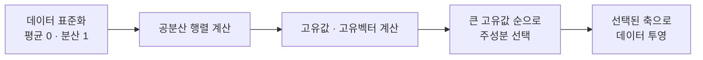

# PCA (주성분 분석)

> **주성분 분석은 데이터가 가장 넓게 퍼진 방향들을 새 축으로 삼아, 분산을 최대한 지키면서 차원을 줄이는 선형 기법이다.**

## 데이터를 가장 잘 보여주는 각도에서 사진 찍기

럭비공을 사진 한 장으로 설명한다고 하자. 옆에서 길쭉한 방향으로 찍으면 공의 형태가 잘 드러나지만, 정면에서 찍으면 그냥 동그란 원으로 뭉개진다. **PCA는 데이터가 가장 길게 퍼진 방향, 즉 정보가 가장 많이 담긴 각도를 찾아 그쪽에서 사진을 찍는 일이다.** 이때 "가장 길게 퍼진"을 수학적으로는 **분산이 최대인 방향**이라 부르고, 그 방향을 **주성분**이라 한다.

첫 번째 주성분은 분산이 가장 큰 방향, 두 번째 주성분은 첫 번째와 **직교하면서** 남은 분산이 가장 큰 방향, 이런 식으로 이어진다. 주성분들이 서로 직교한다는 건 서로 겹치지 않는 정보를 담는다는 뜻이다. 앞쪽 몇 개의 주성분만 남기면 정보 대부분을 지키면서 차원이 확 준다.

## 공분산 행렬의 고유벡터가 주성분이다

PCA의 계산은 정해진 순서를 따른다.

- **표준화**: 변수마다 단위가 다르면 큰 숫자가 분산을 지배하므로, 먼저 스케일을 맞춘다.
- **공분산 행렬**: 변수들이 어떻게 함께 변하는지를 담은 행렬이다.
- **고유벡터·고유값**: 공분산 행렬의 고유벡터가 곧 주성분(축의 방향)이고, 대응하는 고유값이 그 축이 설명하는 분산의 크기다.
- **선택**: 고유값이 큰 순으로 원하는 개수만큼 축을 남긴다. 각 축이 설명하는 분산 비율(explained variance ratio)을 누적해 몇 개를 남길지 정한다.

## 흔한 오해

> ⚠️ **흔한 오해 — "PCA는 원래 변수 중 중요한 것을 골라준다."**
>
> PCA는 변수를 고르는 게 아니라 **모든 변수를 조합한 새 축**을 만든다. 그래서 주성분은 원래 변수처럼 "나이"나 "연봉" 같은 이름을 갖지 못하고 해석이 어렵다. 있는 변수 중에서 고르는 것은 특성 선택이지 PCA가 아니다.

> ⚠️ **흔한 오해 — "PCA는 아무 데이터에나 잘 통한다."**
>
> PCA는 **선형** 기법이라 직선 방향의 분산만 잡는다. 데이터가 곡면이나 나선처럼 비선형 구조로 얽혀 있으면 PCA는 이를 제대로 펴지 못한다. 그럴 땐 [t-SNE](tSNE.md) 같은 비선형 기법이 낫다.

## 정리하면

- PCA는 분산이 큰 방향을 새 축(주성분)으로 삼아 차원을 줄이는 **선형** 기법이다.
- 주성분은 공분산 행렬의 고유벡터이며, 고유값이 그 축의 설명력을 나타낸다.
- 앞쪽 소수의 주성분만 남겨 정보를 지키면서 차원을 압축한다.
- 새 축은 조합된 것이라 해석이 어렵고, 비선형 구조에는 약하다.

## 함께 읽기

- [Dimensionality Reduction](Dimensionality_Reduction.md) — PCA가 속한 큰 범주.
- [t-SNE](tSNE.md) — PCA가 놓치는 비선형 구조를 살리는 시각화 기법.
- [Feature Engineering](Feature_Engineering.md) — PCA는 특성 추출로 차원을 줄이는 한 방법.
