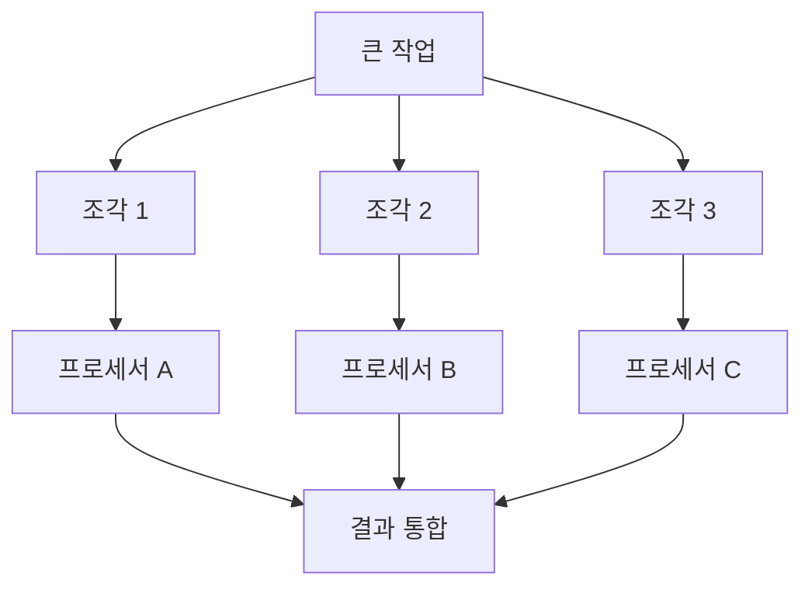

# Parallel Computing (병렬 컴퓨팅)

> **병렬 컴퓨팅은 하나의 큰 작업을 여러 조각으로 쪼개 여러 처리 장치가 동시에 처리하게 해서 시간을 줄이는 방식이다.**

## 벽돌을 여럿이 나눠 나르는 것과 같다

혼자 벽돌 1000장을 나르면 오래 걸리지만, 열 명이 100장씩 나누면 대략 10분의 1 시간이면 끝난다. 병렬 컴퓨팅의 발상이 딱 이것이다. **한 명(하나의 프로세서)이 순서대로 다 하는 대신, 여럿이 동시에 나눠 한다.**

- **작업 분할(divide)** — 문제를 서로 독립적인 조각으로 나눈다.
- **동시 실행(parallel)** — 각 조각을 여러 프로세서·코어·GPU·컴퓨터에 맡겨 한꺼번에 돌린다.
- **결과 통합(combine)** — 각자 끝낸 결과를 하나로 합친다.

## 나눌 수 없는 부분이 전체 속도의 발목을 잡는다

일꾼을 열 배로 늘려도 속도가 딱 열 배가 되진 않는다. 벽돌을 어떻게 나눌지 지시하고, 다 나른 뒤 정리하는 것처럼 **혼자 순서대로 해야만 하는 부분(직렬 구간)**이 남기 때문이다.

> 💡 **참고 — 암달의 법칙(Amdahl's law)**
>
> 프로그램에서 병렬화할 수 없는 직렬 부분의 비율이 속도 향상의 천장을 정한다. 예컨대 작업의 5%가 직렬이면, 프로세서를 아무리 늘려도 전체 속도는 최대 20배를 넘지 못한다. **"코어를 늘릴수록 무한히 빨라진다"는 착각을 깨는 법칙이다.**

또 하나의 비용은 **조율**이다. 프로세서끼리 데이터를 주고받고([메시지 전달](Distributed_Computing.md)), 공유 자원을 놓고 충돌하지 않게 순서를 맞추는 데도 시간이 든다. 조각을 잘게 나눌수록 계산은 분산되지만 조율 비용은 커진다.

## 흔한 오해

> ⚠️ **흔한 오해 — "병렬 컴퓨팅과 분산 컴퓨팅은 같은 말이다."**
>
> 겹치지만 초점이 다르다. 병렬 컴퓨팅은 대개 **한 시스템 안의 여러 코어·GPU가 메모리를 공유**하며 동시에 처리하는 데 방점이 있고, [분산 컴퓨팅](Distributed_Computing.md)은 **네트워크로 묶인 여러 대의 독립 컴퓨터**가 각자 메모리를 갖고 협력하는 데 방점이 있다.

## 정리하면

- 병렬 컴퓨팅은 **큰 작업을 쪼개 여러 처리 장치가 동시에 처리**해 시간을 줄인다.
- 분할 → 동시 실행 → 통합의 흐름을 탄다.
- **직렬 구간(암달의 법칙)과 조율 비용** 때문에 속도 향상에는 천장이 있다.
- GPU를 활용한 딥러닝 학습이 대표적 수혜 분야다.

## 함께 읽기

- [Distributed Computing](Distributed_Computing.md) — 여러 대의 독립 컴퓨터로 확장한 사촌 개념.
- [Deep Learning](Deep_Learning.md) — GPU 병렬 연산 덕에 실용화된 대표 분야.
