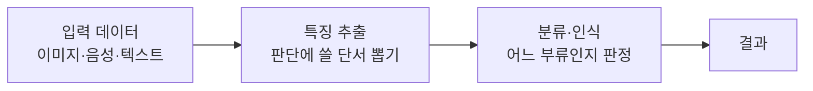

# Pattern Recognition (패턴인식)

> **패턴인식은 데이터 속에 반복되는 규칙성을 찾아, 새 데이터가 어느 부류에 속하는지 알아맞히는 일이다.**

## 군중 속에서 친구 얼굴을 알아보는 능력이다

사람은 붐비는 지하철에서도 친구 얼굴을 순식간에 골라낸다. 눈·코·입의 배치라는 **패턴**을 알아보기 때문이다. 패턴인식은 이 능력을 기계에 옮기는 분야다. **손글씨 숫자, 지문, 음성, 비정상 거래 — 겉모습은 매번 조금씩 달라도 그 밑에 깔린 공통 형태를 잡아내는 것**이 핵심이다.

그래서 패턴인식은 두 걸음으로 움직인다.

1. **특징 추출(feature extraction)** — 원 데이터에서 판단에 쓸 만한 단서를 뽑는다. 얼굴이라면 눈 사이 거리·윤곽선 같은 것.
2. **분류(classification)** — 그 특징을 보고 어느 부류에 속하는지 정한다. "이 얼굴은 친구 A다."

## 무엇으로 배우느냐에 따라 갈린다

패턴을 익히는 방식은 [머신러닝](Machine_Learning.md)의 갈래를 그대로 따른다. 정답이 붙은 예시로 배우면 [지도학습](Supervised_Learning.md) 방식의 분류이고, 정답 없이 비슷한 것끼리 묶으면 [비지도학습](Unsupervised_Learning.md) 방식의 [군집화](Clustering.md)다.

> 💡 **참고 — 딥러닝이 바꾼 지점**
>
> 예전에는 사람이 "어떤 특징을 뽑을지"를 손으로 설계했다. [딥러닝](Deep_Learning.md)의 등장 이후로는 신경망이 특징 추출과 분류를 **한꺼번에 데이터로부터 학습**한다. 얼굴 인식·음성 인식 성능이 껑충 뛴 이유다.

## 흔한 오해

> ⚠️ **흔한 오해 — "패턴인식은 머신러닝과 같은 말이다."**
>
> 완전히 같지는 않다. 패턴인식은 **"데이터에서 규칙을 찾아 분류·식별한다"는 문제(목표)**를 가리키고, [머신러닝](Machine_Learning.md)은 그 문제를 푸는 **방법론**이다. 오늘날 패턴인식은 대부분 머신러닝으로 구현되지만, 개념적으로는 문제와 도구의 관계다.

## 정리하면

- 패턴인식은 **데이터 속 규칙성을 찾아 새 입력을 부류로 판정**하는 일이다.
- 특징 추출 → 분류의 두 걸음으로 움직인다.
- 정답 유무에 따라 지도학습 분류와 비지도학습 군집화로 갈린다.
- 딥러닝은 특징 설계와 분류를 통째로 학습해 성능을 크게 끌어올렸다.

## 함께 읽기

- [Machine Learning](Machine_Learning.md) — 오늘날 패턴인식을 구현하는 주된 방법론.
- [Deep Learning](Deep_Learning.md) — 특징 추출까지 스스로 배워 패턴인식을 도약시킨 분야.
- [Supervised Learning](Supervised_Learning.md) — 정답을 보고 분류 규칙을 배우는 방식.
- [Clustering](Clustering.md) — 정답 없이 비슷한 것끼리 묶는 비지도 패턴 찾기.
