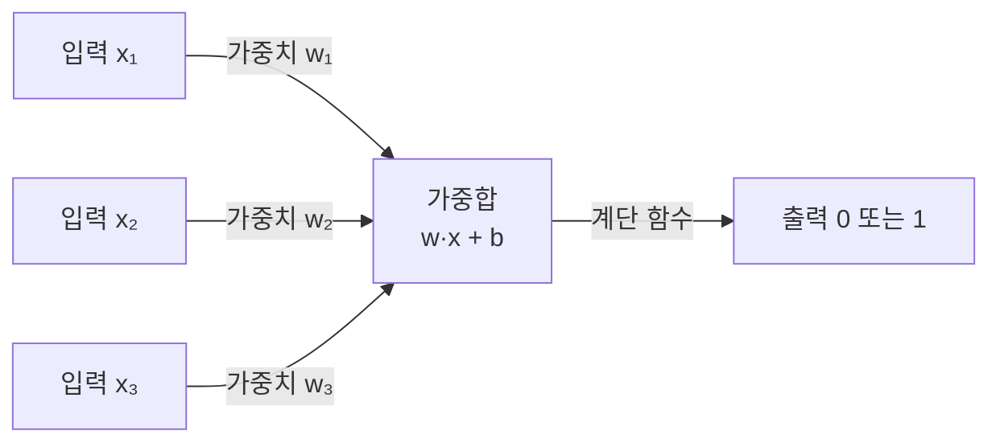

# Perceptron (퍼셉트론)

> **퍼셉트론은 입력에 가중치를 곱해 더한 뒤 임계값을 넘으면 1, 못 넘으면 0을 내는 가장 단순한 인공 뉴런이자, 오늘날 신경망의 시조다.**

## 여러 의견에 가중치를 매겨 하나의 결정을 내리는 심사위원과 같다

여러 심사위원의 점수를 받아 합격/불합격을 정한다고 해보자. 어떤 심사위원의 말은 더 무겁게, 어떤 말은 가볍게 반영한 뒤, 합산 점수가 기준선을 넘으면 합격이다. **퍼셉트론이 하는 계산이 정확히 이 구조다.** 각 입력에 붙는 **가중치**가 그 입력의 중요도이고, **편향**은 기준선을 올리거나 내리는 손잡이이며, 합이 문턱을 넘는지 보는 것이 **활성화**다.

1957년 프랭크 로젠블랫이 제안한 이 모델은, 자극과 반응을 잇는 신경세포 하나를 수학으로 흉내 낸 것이다.

## 가중합에 계단 함수를 씌워 0 아니면 1을 낸다

한 번의 예측은 이렇게 흐른다.



수식으로는 `y = step(w·x + b)`다. 가중합이 0 이상이면 1, 아니면 0을 낸다.

학습은 **틀린 만큼 가중치를 밀어주는** 방식이다. 예측이 맞으면 그대로 두고, 틀리면 정답 방향으로 가중치를 조금씩 고친다.

```
w ← w + η·(정답 − 예측)·x
```

여기서 `η`는 얼마나 크게 고칠지 정하는 학습률이다. 데이터가 직선(고차원에서는 초평면) 하나로 두 범주가 갈리는 **선형 분리 가능** 상태라면, 이 규칙은 유한한 횟수 안에 반드시 답을 찾는다(퍼셉트론 수렴 정리).

## 흔한 오해

> ⚠️ **흔한 오해 — "퍼셉트론을 여러 개 쓰면 뭐든 풀 수 있다."**
>
> 단일 퍼셉트론은 선형으로 나뉘는 문제만 푼다. 그 유명한 XOR처럼 직선 하나로 못 가르는 문제는 못 푼다(민스키·페퍼트, 1969). 이 한계를 뚫으려면 퍼셉트론을 층층이 쌓고 비선형 [활성화 함수](Activation_Function.md)를 넣은 [다층 퍼셉트론](Multilayer_Perceptron.md)이 필요하며, 이를 학습시키는 열쇠가 [역전파](Backpropagation.md)다.

## 정리하면

- 퍼셉트론은 **가중합 + 계단 함수**로 0/1을 내는 가장 단순한 인공 뉴런이다.
- 학습은 **틀린 만큼 가중치를 정답 쪽으로 미는** 규칙으로 이뤄진다.
- **선형 분리 가능한** 문제만 풀 수 있고, XOR 같은 비선형 문제는 못 푼다.
- 이 한계를 넘으려 층을 쌓은 것이 다층 퍼셉트론이며, 신경망의 출발점이다.

## 함께 읽기

- [Multilayer Perceptron](Multilayer_Perceptron.md) — 퍼셉트론을 층으로 쌓아 비선형 문제까지 푸는 확장판.
- [Neural Network](Neural_Network.md) — 퍼셉트론이 뉴런 하나로 들어가는 더 큰 그림.
- [Activation Function](Activation_Function.md) — 계단 함수를 대신해 비선형성을 넣는 함수들.
- [Adaline](Adaline.md) — 퍼셉트론과 거의 동시대의 사촌 모델. 학습 규칙이 다르다.
- [Gradient Descent](Gradient_Descent.md) — 다층으로 넘어가면 가중치를 이 방법으로 조정한다.
