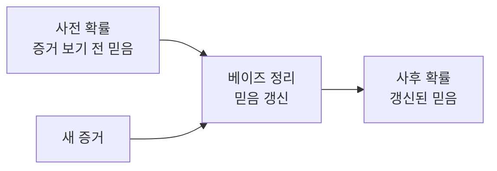

# Probabilistic Reasoning (확률추론)

> **확률추론은 "참·거짓"으로 딱 잘라 말할 수 없는 불확실한 상황에서, 각 가능성에 확률을 매기고 새 증거로 그 확률을 갱신해 판단하는 방법이다.**

## 의사가 검사 결과로 진단을 고쳐가는 것과 같다

환자가 기침을 한다. 의사는 처음엔 "감기일 확률이 높다"고 본다. 그런데 X레이에서 이상 소견이 나오면 판단을 고친다 — "폐렴 가능성이 커졌다." **새 증거가 들어올 때마다 각 진단의 그럴듯함을 다시 계산하는 것**, 이게 확률추론의 전부다.

전통적 논리는 "참 아니면 거짓"만 다루지만, 현실은 애매하다. 확률추론은 이 애매함을 회피하지 않고 **숫자(확률)로 다룬다.**

- **사전 확률(prior)** — 증거를 보기 전의 믿음. "이 계절엔 감기가 흔하다."
- **증거(evidence)** — 새로 들어온 정보. "X레이 이상 소견."
- **사후 확률(posterior)** — 증거를 반영해 갱신한 믿음. "이제는 폐렴이 더 의심된다."

## 베이즈 정리가 믿음을 갱신하는 엔진이다

세 조각을 잇는 공식이 [베이즈 정리](Bayesian_Inference.md)다.

```text
사후 확률 = ( 우도 × 사전 확률 ) / 증거의 확률

P(원인│증거) = P(증거│원인) · P(원인) / P(증거)
```

말로 풀면 이렇다. **"이 원인이라면 이 증거가 나올 만한가(우도)"와 "애초에 이 원인이 흔한가(사전 확률)"를 곱해, 증거를 봤을 때의 믿음(사후 확률)을 얻는다.**



이 갱신을 변수가 여럿 얽힌 상황으로 확장한 것이 [베이즈 네트워크](Bayesian_Network.md)이고, 시간에 따라 상태가 변하는 상황에 적용한 것이 [은닉 마르코프 모델](Hidden_Markov_Model.md)이다.

## 흔한 오해

> ⚠️ **흔한 오해 — "확률추론은 애매하게 얼버무리는 것이다."**
>
> 반대다. 확률추론은 불확실성을 **얼버무리는 대신 숫자로 명시**하고, 새 증거가 오면 정해진 규칙(베이즈 정리)으로 일관되게 고친다. "잘 모르겠다"를 "70% 가능성"으로 정량화하는, 오히려 더 엄밀한 태도다. 참고로 이는 애매함의 정도를 다루는 [퍼지 논리](Fuzzy_Logic.md)와는 결이 다른 접근이다.

## 정리하면

- 확률추론은 불확실한 상황에서 **가능성마다 확률을 매기고 증거로 갱신**해 판단한다.
- 사전 확률 → 증거 → 사후 확률의 흐름을 [베이즈 정리](Bayesian_Inference.md)가 잇는다.
- 변수가 얽히면 베이즈 네트워크로, 시간이 흐르면 은닉 마르코프 모델로 확장된다.
- 불확실성을 회피하는 게 아니라 숫자로 명시하는 엄밀한 방법이다.

## 함께 읽기

- [Bayesian Inference](Bayesian_Inference.md) — 확률추론의 심장인 베이즈 정리를 다룬다.
- [Bayesian Network](Bayesian_Network.md) — 여러 변수의 확률 관계를 그래프로 엮은 확장.
- [Hidden Markov Model](Hidden_Markov_Model.md) — 시간에 따라 변하는 상태를 확률로 추론하는 모델.
- [Approximate Reasoning](Approximate_Reasoning.md) — 불확실·불완전한 정보로 추론하는 더 넓은 갈래.
