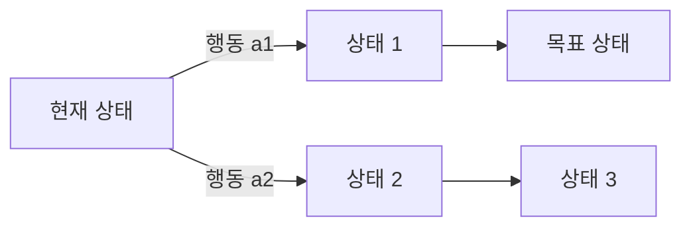

# Problem Solving (문제해결)

> **AI에서 문제해결은 지금 상태에서 목표 상태까지, 가능한 상태들의 미로를 탐색해 길을 찾아내는 일이다.**

## 미로에서 출구를 찾는 것과 같다

퍼즐 게임을 떠올려 보자. 지금 놓인 조각 배치가 **현재 상태**, 다 맞춘 그림이 **목표 상태**다. 조각 하나를 옮기는 것이 하나의 **행동**이고, 그 행동으로 다른 배치로 넘어간다. 문제해결이란 결국 **현재에서 목표까지 이어지는 행동의 순서를 찾는 것**이다.

이 그림을 형식화한 것이 AI의 고전적 문제해결 틀이다.

- **[상태공간](State_Space.md)(state space)** — 도달 가능한 모든 상태의 집합. 미로의 모든 칸.
- **행동(action)** — 한 상태를 다른 상태로 옮기는 조작. 미로에서 한 칸 이동.
- **목표 검사(goal test)** — 지금 상태가 목표인지 확인.
- **경로 비용(path cost)** — 그 길에 든 값. 짧을수록 좋다.

## 무작정 뒤지느냐, 힌트를 쓰느냐로 탐색이 갈린다

문제해결의 핵심은 이 상태공간을 **어떻게 탐색하느냐**다. 크게 두 갈래다.

| 갈래 | 방식 | 예 |
|------|------|-----|
| 맹목적 탐색 | 목표까지의 거리 힌트 없이 순서대로 훑는다 | [너비우선](Breadth_First_Search.md), [깊이우선](Depth_First_Search.md) |
| 정보 이용 탐색 | 목표에 가까워 보이는 쪽을 [휴리스틱](Heuristic.md)으로 우선 살핀다 | [A* 알고리즘](A_Algorithm.md) |

상태공간이 조금만 커져도 경우의 수가 폭발하기 때문에, **"어디를 먼저 볼지"를 똑똑하게 정하는 것**이 관건이다. 목표에 얼마나 가까운지 어림하는 휴리스틱이 탐색을 극적으로 줄여 준다.

> 💡 **참고 — 문제를 "제약"으로 보는 시각도 있다**
>
> 모든 문제가 미로 탐색으로 잘 맞는 건 아니다. 스도쿠나 시간표 짜기처럼 "지켜야 할 조건들"이 핵심인 문제는 [제약조건 만족 문제](Constraint_Satisfaction_Problem.md)로 보는 편이 낫다. 문제를 어떤 틀로 옮기느냐가 풀이 난이도를 좌우한다.

## 흔한 오해

> ⚠️ **흔한 오해 — "AI의 문제해결은 사람처럼 통찰로 답을 떠올린다."**
>
> 고전적 AI의 문제해결은 통찰이 아니라 **체계적인 탐색**이다. 가능한 상태를 규칙에 따라 펼치고, 목표에 이르는 경로를 찾을 때까지 훑는다. 사람의 직관과 달리 명시적인 상태·행동·목표로 정의되어야 작동한다.

## 정리하면

- AI의 문제해결은 **상태공간에서 현재→목표로 가는 행동 순서를 탐색**하는 일이다.
- 상태·행동·목표 검사·경로 비용으로 문제를 형식화한다.
- 탐색은 맹목적 탐색과 휴리스틱을 쓰는 정보 이용 탐색으로 갈린다.
- 문제를 탐색으로 볼지 제약 만족으로 볼지, 틀을 잘 고르는 게 절반이다.

## 함께 읽기

- [State Space](State_Space.md) — 문제해결이 헤집고 다니는 모든 상태의 지도.
- [Heuristic](Heuristic.md) — 어디를 먼저 볼지 알려주는 어림짐작. 탐색을 극적으로 줄인다.
- [A* Algorithm](A_Algorithm.md) — 휴리스틱을 써서 최단 경로를 효율적으로 찾는 대표 알고리즘.
- [Breadth First Search](Breadth_First_Search.md) — 가장 기본적인 맹목적 탐색의 하나.
- [Constraint Satisfaction Problem](Constraint_Satisfaction_Problem.md) — 문제를 제약의 집합으로 보는 다른 틀.
