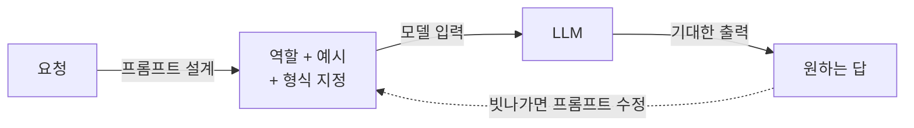

# Prompt Engineering (프롬프트 엔지니어링)

> **프롬프트 엔지니어링은 모델의 가중치는 그대로 둔 채, 입력 문장(프롬프트)의 표현·구조·예시를 설계해 원하는 출력을 끌어내는 기술이다.**

## 유능하지만 지시에 예민한 신입에게 일을 시키는 것과 같다

능력은 뛰어나지만 눈치는 없는 신입 직원을 떠올려 보자. "잘 좀 정리해줘"라고 하면 엉뚱한 걸 내놓지만, "이 회의록을 세 문단으로 요약하되 결정 사항만 굵게 표시해줘"라고 하면 훌륭하게 해낸다. **LLM도 똑같다. 능력은 이미 파라미터 안에 다 들어 있고, 그 능력을 어떤 문장으로 호출하느냐가 결과를 가른다.** 프롬프트 엔지니어링은 이 "지시하는 법"을 다듬는 일이다.

핵심은 모델을 다시 학습시키지 않는다는 점이다. [미세조정](Fine_Tuning.md)이 신입을 재교육하는 것이라면, 프롬프트 엔지니어링은 같은 신입에게 지시서를 더 잘 써주는 것이다. 그래서 **가장 싸고 빠르며, 대부분의 문제는 여기서 먼저 시도한다.**

## 몇 가지 검증된 기법이 있다

프롬프트 설계에는 반복해서 효과가 확인된 패턴들이 있다.

| 기법 | 아이디어 | 예 |
|------|---------|-----|
| [제로샷](Zeroshot_Learning.md) | 예시 없이 지시만 | "다음 문장의 감정을 분류해라" |
| [소수 예제](Fewshot_Learning.md) | 정답 예시 몇 개를 함께 제시 | 입력·출력 쌍 2~3개 보여준 뒤 새 입력 |
| 역할 부여 | 답변자의 관점을 지정 | "너는 숙련된 세무사다" |
| 사고 사슬 (Chain-of-Thought) | "단계별로 생각하라"고 유도 | 추론·수학 문제에서 정답률 상승 |
| 출력 형식 지정 | JSON·표 등 형식을 못박음 | "결과를 JSON으로만 출력해라" |

특히 **사고 사슬(Chain-of-Thought)**은 복잡한 추론에서 눈에 띄게 효과가 크다. 모델에게 결론만 요구하는 대신 중간 추론 과정을 쓰게 하면, 그 과정 자체가 다음 토큰 예측의 발판이 되어 정답률이 오른다.

프롬프트 엔지니어링은 이렇게 **입력을 고치고 결과를 보고 다시 고치는 반복 실험**에 가깝다. 코드를 짜는 게 아니라 지시문을 실험하는 일이다.

## 흔한 오해

> ⚠️ **흔한 오해 — "프롬프트만 잘 쓰면 모델의 지식 한계도 넘을 수 있다."**
>
> 프롬프트는 모델이 이미 가진 능력을 끌어낼 뿐, 없는 지식을 만들어내지 못한다. 모델이 모르는 최신 사실이나 사내 문서가 필요하면 아무리 프롬프트를 다듬어도 [환각](Hallucination.md)이 날 뿐이다. 그럴 땐 [RAG](Retrieval_Augmented_Generation___RAG.md)로 실제 근거 문서를 프롬프트에 넣어줘야 한다.

> 💡 **참고 — 프롬프트에는 한계 용량이 있다.**
> 모델이 한 번에 읽을 수 있는 [토큰](Tokenization.md) 수를 **문맥 창(context window)**이라 한다. 프롬프트가 이 창을 넘으면 앞부분이 잘려나가므로, 무한정 길게 넣을 수는 없다.

## 정리하면

- 프롬프트 엔지니어링은 **가중치를 건드리지 않고 입력 설계로 출력을 조종**하는 기술이다.
- 세 가지 방법(프롬프트·RAG·미세조정) 중 가장 싸고 빠른 첫 시도다.
- 소수 예제, 역할 부여, 사고 사슬, 출력 형식 지정이 검증된 기법이다.
- 없는 지식은 못 만든다. 근거가 필요하면 RAG와 결합한다.

## 함께 읽기

- [Large Language Model - LLM](Large_Language_Model___LLM.md) — 프롬프트가 조종하는 대상.
- [Few-shot Learning](Fewshot_Learning.md) — 프롬프트에 예시를 넣어 새 과제를 푸는 대표 기법.
- [Retrieval-Augmented Generation - RAG](Retrieval_Augmented_Generation___RAG.md) — 프롬프트만으로 부족한 지식을 외부 문서로 보강.
- [Fine-tuning](Fine_Tuning.md) — 프롬프트로 안 되면 모델 자체를 손보는 다음 단계.
