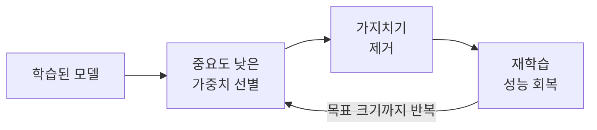

# Pruning (가지치기/프루닝)

> **프루닝은 모델에서 별로 기여하지 않는 연결이나 가중치를 잘라내, 크기와 계산량을 줄이는 경량화 기술이다.**

## 웃자란 나뭇가지를 쳐내 나무를 다듬는 것과 같다

정원사가 나무의 잔가지를 쳐내도 나무는 죽지 않는다. 오히려 모양이 정돈되고 영양이 굵은 가지로 몰린다. **프루닝이 바로 이 가지치기다.** 신경망에는 학습이 끝나고 보면 값이 거의 0에 가까워 출력에 사실상 기여하지 않는 가중치가 수두룩하다. 이런 연결을 잘라내도 예측은 거의 그대로면서, 모델은 작아지고 계산은 가벼워진다.

무엇을 자르느냐로 결이 나뉜다.

- **비구조적 프루닝** — 개별 가중치를 0으로 만든다. 압축률은 높지만 행렬이 듬성듬성해져(희소) 일반 하드웨어에서는 속도 이득을 보기 어렵다.
- **구조적 프루닝** — 채널·필터·뉴런처럼 덩어리째 제거한다. 압축률은 덜해도 실제 연산이 줄어 속도가 확실히 붙는다.

## 자르고, 다시 학습시켜 회복하는 과정을 반복한다

한 번에 많이 자르면 모델이 휘청한다. 그래서 보통 **조금 자르고 → 다시 학습(fine-tuning)으로 성능을 회복시키고 → 또 자르는** 순환을 반복한다.



중요도는 흔히 가중치의 절댓값 크기로 판단한다. 작을수록 출력에 미치는 영향이 적다고 보고 먼저 자른다.

```python
import torch.nn.utils.prune as prune
import torch.nn as nn

layer = nn.Linear(100, 50)
# 이 층의 가중치 중 절댓값이 작은 하위 30%를 0으로 만든다
prune.l1_unstructured(layer, name="weight", amount=0.3)
```

## 흔한 오해

> ⚠️ **흔한 오해 — "프루닝은 과적합을 막으려고 하는 것이다."**
>
> 결정 트리에서 가지를 쳐 [과적합](Overfitting.md)을 줄이는 것도 프루닝이라 부르지만, 신경망에서 말하는 프루닝의 주된 목적은 **모델 경량화와 추론 가속**이다. 정규화로 과적합을 막는 것과는 목적이 다르다. 자른 뒤 재학습으로 성능을 되돌리는 것이 핵심이지, 성능을 일부러 낮추는 게 아니다.

## 정리하면

- 프루닝은 **기여가 적은 연결·가중치를 잘라** 모델을 작고 빠르게 만든다.
- 개별 가중치를 자르는 비구조적, 덩어리째 자르는 구조적 방식이 있다.
- 보통 **자르고 재학습하는 순환**을 반복해 성능을 유지한다.
- 주목적은 경량화·가속이며, 트리 프루닝의 과적합 억제와는 목적이 다르다.

## 함께 읽기

- [Model Quantization](Model_Quantization.md) — 정밀도를 낮춰 경량화하는 다른 축의 기법.
- [Knowledge Distillation](Knowledge_Distillation.md) — 작은 모델에 지식을 옮겨 경량화하는 기법.
- [Regularization](Regularization.md) — 과적합을 억제하는 별개의 기법과 비교하기.
- [Decision Tree](Decision_Tree.md) — 트리에서 가지치기가 과적합을 줄이는 사례.
