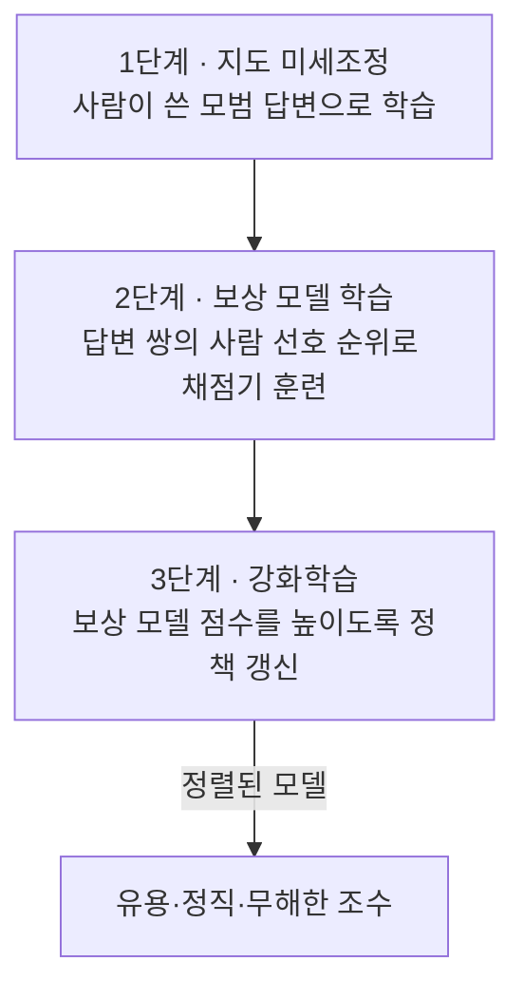

# RLHF (인간 피드백 기반 강화학습)

> **RLHF는 "무엇이 좋은 답인가"를 사람의 선호로 가르쳐, 문법적으로 맞기만 한 모델을 사람이 실제로 원하는 방향으로 정렬(align)시키는 학습 기법이다.**

## 요리는 할 줄 아는데 손님 입맛을 모르는 요리사를 길들이는 것이다

레시피대로 요리는 완벽히 해내지만 "손님이 뭘 좋아하는지"는 모르는 요리사가 있다고 하자. 매번 두 접시를 내놓고 손님이 더 맛있는 쪽을 고르게 하고, 그 선택을 반복 학습시키면 요리사는 점점 손님 입맛에 맞춰간다. **RLHF가 바로 이 과정이다.** 사전학습된 [LLM](Large_Language_Model___LLM.md)은 그럴듯한 문장을 만드는 능력은 있지만, "도움이 되고 정직하고 무해한" 답이 무엇인지는 모른다. RLHF는 사람의 선호를 신호로 삼아 그 감각을 심는다.

이게 필요한 이유는 "다음 단어 맞히기"라는 학습 목표가 인간의 가치와 직접 이어지지 않기 때문이다. 확률적으로 그럴듯한 답이 반드시 유용하거나 안전한 답은 아니다. **RLHF는 이 간극, 즉 "잘 예측하는 것"과 "잘 응답하는 것" 사이를 사람 피드백으로 메운다.** ChatGPT가 날것의 GPT와 달리 공손하고 유용하게 대화하는 결정적 이유가 이것이다.

## 보상 모델을 세우고 그것으로 강화학습한다

RLHF는 보통 세 단계를 거친다. 핵심 발상은 "사람이 매번 채점할 순 없으니, 사람 취향을 흉내 내는 채점기를 먼저 만들자"는 것이다.

1. **지도 미세조정(SFT)**: 사람이 직접 쓴 좋은 질문-답변 예시로 [미세조정](Fine_Tuning.md)해 기본 응답 습관을 잡는다.
2. **보상 모델 학습**: 같은 질문에 대한 여러 답을 사람이 좋은 순서대로 매긴다. 이 순위 데이터로, 답변에 점수를 매기는 **보상 모델(reward model)**을 학습시킨다. 이제 사람 취향을 대신 채점하는 모델이 생겼다.
3. **강화학습**: 보상 모델이 주는 점수를 보상으로 삼아, [강화학습](Reinforcement_Learning.md)(주로 PPO 알고리즘)으로 LLM이 높은 점수를 받는 답을 내도록 조금씩 밀어붙인다.

## 흔한 오해

> ⚠️ **흔한 오해 — "RLHF는 모델을 더 똑똑하게(지식이 많게) 만든다."**
>
> RLHF는 지식을 늘리는 게 아니라 이미 가진 능력을 **사람이 원하는 방식으로 표현하도록 정렬**한다. 아는 것이 많아지는 게 아니라, 아는 것을 유용하고 안전하게 꺼내 놓는 태도가 바뀌는 것이다.

> 💡 **참고 — 사람을 AI로 대체하는 변형도 있다.**
> 사람이 선호를 매기는 일은 비싸고 느리다. 그래서 사람 대신 AI가 선호를 매기는 **RLAIF**, 강화학습 단계를 더 단순한 최적화로 대체하는 **DPO(Direct Preference Optimization)** 같은 후속 기법들이 나왔다. 목표는 같다 — 모델을 인간 선호에 정렬하는 것.

## 정리하면

- RLHF는 **사람의 선호를 신호로 모델을 인간 가치에 정렬**하는 기법이다.
- "다음 단어 예측"과 "유용·안전한 응답" 사이의 간극을 메운다.
- 지도 미세조정 → 보상 모델 학습 → 강화학습의 3단계로 진행된다.
- 지식이 아니라 **행동과 태도**를 바꾸며, DPO·RLAIF 같은 변형이 있다.

## 함께 읽기

- [Reinforcement Learning](Reinforcement_Learning.md) — RLHF의 세 번째 단계가 딛고 선 학습 틀.
- [Large Language Model - LLM](Large_Language_Model___LLM.md) — RLHF가 정렬하는 대상.
- [Fine-tuning](Fine_Tuning.md) — RLHF의 1단계이자 더 넓은 상위 개념.
- [Hallucination](Hallucination.md) — RLHF로 완전히는 못 없애는, 정렬의 한계가 드러나는 문제.
