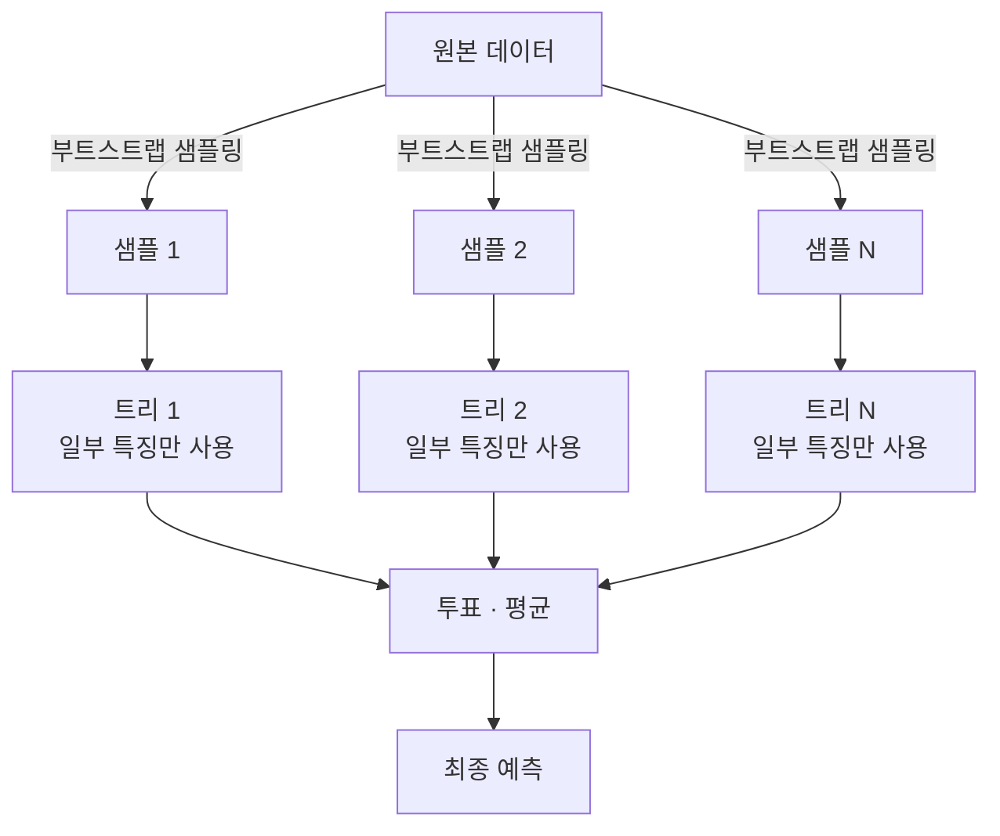

# Random Forest (랜덤 포레스트)

> **랜덤 포레스트는 서로 조금씩 다르게 자란 결정 트리 수백 그루의 예측을 투표로 모아, 한 그루의 변덕을 다수의 지혜로 눌러버리는 앙상블 기법이다.**

## 한 전문가보다 다양한 배심원단이 낫다

한 사람의 판단은 편향되기 쉽다. 하지만 서로 다른 경험을 가진 배심원 여럿이 각자 판단하고 다수결로 결론을 내면, 개인의 실수가 서로 상쇄돼 더 안정적인 답이 나온다. **랜덤 포레스트는 이 배심원단을 결정 트리로 구성한 것이다.** 트리 하나하나는 [과적합](Overfitting.md)에 취약해 데이터의 잡음까지 외우곤 하지만, 다르게 자란 트리를 많이 모아 평균 내면 그 변덕이 씻겨나간다.

핵심은 **"서로 다르게" 자라게 만드는 것**이다. 똑같은 트리를 백 그루 모아봐야 똑같이 틀릴 뿐이다. 랜덤 포레스트는 두 겹의 무작위성으로 트리들을 서로 다르게 만든다.

## 두 번의 무작위 추출로 트리를 다양하게 만든다

1. **행 무작위 (배깅):** 원본 데이터에서 **중복을 허용해** 무작위로 뽑은(부트스트랩) 표본으로 각 트리를 학습시킨다. 트리마다 보는 데이터가 조금씩 다르다.
2. **열 무작위 (특징 샘플링):** 각 노드를 나눌 때 전체 특징이 아니라 **무작위로 고른 일부 특징 중에서만** 최적 분할을 찾는다. 이 두 번째 무작위가 랜덤 포레스트를 단순 배깅과 구별 짓는 핵심이다. 강한 특징 하나에 모든 트리가 쏠리는 것을 막아 트리들의 상관관계를 낮춘다.
3. **집계:** 분류면 **다수결 투표**, 회귀면 **평균**으로 최종 예측을 낸다.

덤으로, 각 트리 학습에 쓰이지 않은 표본(out-of-bag)으로 별도 검증 없이 성능을 가늠할 수 있고, 특징별 기여도인 **특성 중요도**도 얻는다.

## 흔한 오해

> ⚠️ **흔한 오해 — "트리를 많이 만드니까 개별 트리보다 항상 과적합이 심할 것이다."**
>
> 반대다. 개별 트리는 깊게 자라며 과적합하지만, 다르게 자란 트리를 **평균 내는 것 자체가 분산을 줄여** 과적합을 완화한다. 트리 수를 늘려도 과적합이 더 심해지지 않고 오히려 예측이 안정된다.

## 정리하면

- 랜덤 포레스트는 **여러 결정 트리의 투표·평균**으로 예측하는 앙상블이다.
- **부트스트랩(행)** 과 **특징 샘플링(열)** 이라는 두 겹 무작위로 트리를 서로 다르게 만든다.
- 트리들의 상관을 낮춰 **분산을 줄이고 과적합을 완화**한다.
- 튜닝 없이도 잘 돌아가고 특성 중요도까지 주지만, 트리 하나만큼 해석이 쉽지는 않다.

## 함께 읽기

- [Decision Tree](Decision_Tree.md) — 랜덤 포레스트를 이루는 기본 단위.
- [Ensemble Methods](Ensemble_Methods.md) — 여러 모델을 모아 성능을 높이는 큰 틀. 랜덤 포레스트는 그 대표 사례다.
- [Gradient Boosting](Gradient_Boosting.md) — 같은 트리 앙상블이지만 병렬이 아니라 순차로 오차를 줄여가는 다른 방식.
- [Overfitting](Overfitting.md) — 랜덤 포레스트가 억제하려는 바로 그 문제.
