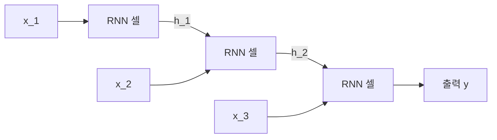

# Recurrent Neural Network – RNN (순환 신경망)

> **순환 신경망은 이전 시점의 은닉 상태를 다음 시점 입력과 함께 받아, 시간 순서가 있는 데이터를 한 요소씩 처리하는 신경망이다.**

## 문장을 읽으며 앞 내용을 기억하는 독자와 같다

책을 읽을 때 우리는 앞 문장을 머릿속에 담은 채 다음 문장을 읽는다. 지금 단어의 의미는 앞서 읽은 맥락에 따라 달라지기 때문이다. **순환 신경망(RNN)이 바로 이 방식으로 시퀀스를 처리한다.**

일반 신경망은 입력을 통째로 한 번에 받지만, RNN은 시퀀스를 **한 요소씩 순서대로** 읽는다. 그리고 매 시점마다 지금까지 읽은 요약을 **은닉 상태(hidden state)**라는 기억에 담아 다음 시점으로 넘긴다. 이 "넘김"이 곧 순환(recurrent)이며, 덕분에 과거 정보가 현재 판단에 흘러든다.

## 은닉 상태를 매 시점 갱신하며 시퀀스를 따라간다

시점 `t`에서 RNN은 현재 입력 `x_t`와 이전 은닉 상태 `h_{t-1}`을 합쳐 새 은닉 상태 `h_t`를 만든다.

```
h_t = tanh(W_x · x_t + W_h · h_{t-1} + b)
y_t = W_y · h_t          # 필요 시 출력
```

여기서 중요한 점은 **모든 시점이 같은 가중치 `W`를 공유한다**는 것이다. 시퀀스가 아무리 길어도 파라미터 수는 늘지 않는다. 아래처럼 시간축으로 펼쳐(unroll) 보면, 같은 셀이 반복 적용되며 은닉 상태가 옆으로 전달되는 구조가 보인다.



## 흔한 오해

> ⚠️ **흔한 오해 — "RNN은 긴 문맥도 잘 기억한다."**
>
> RNN의 가장 큰 약점이 바로 **긴 의존성**이다. 같은 가중치를 반복해 곱하다 보면 기울기가 0으로 사라지거나(기울기 소실) 폭발해, 멀리 떨어진 정보를 학습하기 어렵다. 이 한계를 게이트로 완화한 것이 [LSTM](Long_ShortTerm_Memory___LSTM.md)과 [GRU](GRU.md)이고, 순환을 아예 버리고 어텐션으로 대체한 것이 [트랜스포머](Transformer.md)다.

> 💡 **참고 — RNN이 순차적이라 느리다**
>
> `h_t`를 구하려면 `h_{t-1}`이 먼저 있어야 하므로 시점을 병렬로 계산할 수 없다. 이 순차 의존성이 GPU 병렬화를 가로막아, 대규모 학습에서 트랜스포머에 밀린 또 다른 이유가 됐다.

## 정리하면

- RNN은 **은닉 상태를 시점 사이로 넘기며** 시퀀스를 한 요소씩 처리한다.
- 모든 시점이 **같은 가중치를 공유**해 시퀀스 길이와 무관하게 파라미터가 일정하다.
- **기울기 소실**로 긴 의존성에 약하고, 순차 계산이라 병렬화가 어렵다.
- 이 한계를 LSTM·GRU가 게이트로, 트랜스포머가 어텐션으로 극복했다.

## 함께 읽기

- [Long Short-Term Memory – LSTM](Long_ShortTerm_Memory___LSTM.md) — 게이트로 긴 의존성 문제를 완화한 RNN.
- [GRU](GRU.md) — LSTM을 간소화한 순환 셀.
- [Transformer](Transformer.md) — 순환을 버리고 어텐션으로 시퀀스를 다루는 후계 구조.
- [Neural Network](Neural_Network.md) — RNN이 확장하는 기본 신경망.
- [Word Embedding](Word_Embedding.md) — 단어를 RNN 입력 벡터로 바꾸는 방법.
