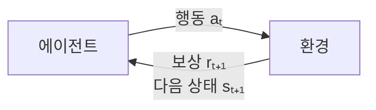

# Reinforcement Learning (강화학습)

> **강화학습은 정답을 알려주는 교사 없이, 행동하고 보상을 받아보며 시행착오로 "무엇을 하면 이득인지"를 스스로 터득하는 학습 방식이다.**

## 간식으로 강아지를 훈련시키는 것과 같다

강아지에게 "앉아"를 가르칠 때 우리는 정답 동작을 직접 손으로 만들어주지 않는다. 잘하면 간식을 주고, 아니면 안 준다. 강아지는 그 보상을 통해 어떤 행동이 이득인지 스스로 알아낸다. **강화학습이 바로 이 방식이다.** 정답 레이블 대신 **보상**이라는 신호만 주고, 학습 주체가 시행착오로 좋은 행동을 찾아가게 한다.

이 점에서 강화학습은 정답이 달린 [지도학습](Supervised_Learning.md)과도, 정답 없이 구조만 찾는 [자율학습](Unsupervised_Learning.md)과도 다르다. 강화학습에는 **행동에 뒤따르는 보상**이라는 제3의 신호가 있다.

## 에이전트와 환경이 주고받는 순환 고리다

강화학습은 다섯 요소가 맞물려 돈다.

- **에이전트(agent):** 학습하고 행동을 결정하는 주체.
- **환경(environment):** 에이전트가 놓인 세계. 행동을 받아 상태를 바꾸고 보상을 돌려준다.
- **상태(state):** 지금 환경이 어떤 상황인지에 대한 정보.
- **행동(action):** 에이전트가 그 상태에서 취할 수 있는 선택.
- **보상(reward):** 행동의 결과로 오는 점수. 이걸 **길게 봐서 최대로 쌓는 것**이 목표다.

에이전트가 상태를 보고 어떤 행동을 할지 정하는 규칙을 **정책(policy)** 이라 한다. 학습이란 이 정책을 보상이 커지는 쪽으로 다듬는 과정이다. 핵심 긴장은 **탐험과 활용(exploration vs exploitation)** 사이에 있다. 이미 아는 좋은 행동만 반복(활용)하면 더 나은 길을 놓치고, 새로운 행동만 시도(탐험)하면 아는 이득을 못 챙긴다. 둘의 균형이 관건이다.

대표 알고리즘으로는 상태-행동의 가치를 표로 학습하는 **Q-러닝**, **SARSA**, 정책을 직접 다듬는 **정책 경사(Policy Gradient)** 등이 있다.

## 흔한 오해

> ⚠️ **흔한 오해 — "당장 보상 큰 행동만 고르면 된다."**
>
> 강화학습이 어려운 이유는 보상이 **미뤄지기** 때문이다. 지금 손해 보는 수가 나중에 큰 이득으로 돌아오기도 한다(바둑에서 한 수를 버려 대국을 이기듯). 그래서 에이전트는 즉각 보상이 아니라 **미래까지 누적될 보상의 기댓값**을 보고 판단해야 한다. 미래 보상을 얼마나 중시할지는 할인율(γ)로 조절한다.

## 정리하면

- 강화학습은 정답 대신 **보상**을 신호 삼아, 시행착오로 좋은 **정책**을 찾는다.
- **에이전트–환경**이 행동·상태·보상을 주고받는 순환 고리로 돌아간다.
- **탐험과 활용의 균형**, 그리고 **미뤄진 보상**을 다루는 것이 핵심 과제다.
- 게임(알파고), 로봇 제어, 자율주행 등 순차적 의사결정 문제에 강하다.

## 함께 읽기

- [Machine Learning](Machine_Learning.md) — 강화학습이 지도·자율학습과 나란히 속하는 세 갈래 중 하나.
- [Supervised Learning](Supervised_Learning.md) — 정답을 주는 학습. 강화학습과의 차이를 보면 개념이 또렷해진다.
- [Agent](Agent.md) — 강화학습의 주인공인 에이전트 개념.
- [RLHF](RLHF.md) — 사람의 선호를 보상으로 삼아 대규모 언어 모델을 다듬는, 강화학습의 대표적 현대 응용.
