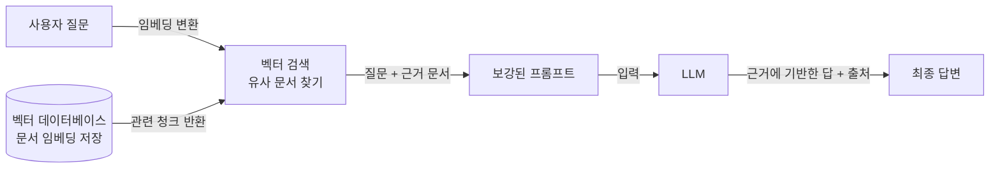

# Retrieval-Augmented Generation - RAG (검색 증강 생성)

> **RAG는 답을 생성하기 직전에 관련 문서를 검색해 프롬프트에 끼워 넣어, 모델이 자기 기억이 아니라 실제 근거를 보고 답하게 만드는 기법이다.**

## 오픈북 시험을 치르게 하는 것이다

기억에만 의존해 시험을 보는 학생은 헷갈리면 아무 말이나 지어낸다. 하지만 **관련 페이지를 펼쳐놓고 보면서 답하는 오픈북 시험**이라면 이야기가 다르다. 근거를 확인하고 답하니 정확하고, 어디서 봤는지 출처도 댈 수 있다. RAG가 바로 LLM에게 오픈북 시험을 치르게 하는 방법이다.

[LLM](Large_Language_Model___LLM.md)은 학습 시점에 본 내용만 파라미터에 압축해 갖고 있다. 그래서 학습 이후의 사건, 사내 문서, 특정 제품 매뉴얼은 알 수 없고, 모르면 그럴듯하게 [환각](Hallucination.md)을 지어낸다. **RAG는 모델을 다시 학습시키는 대신, 질문할 때마다 필요한 지식을 찾아서 함께 건네준다.**

## 검색과 생성을 이어붙인 파이프라인이다

RAG의 핵심은 "먼저 찾고(retrieve), 그다음 생성한다(generate)"는 순서다.

동작을 풀어 쓰면 이렇다.

1. **사전 준비**: 문서들을 잘게 쪼갠 뒤 각 조각을 [임베딩](Embedding.md)(의미를 담은 숫자 벡터)으로 바꿔 [벡터 데이터베이스](Vector_Database.md)에 저장한다.
2. **검색**: 사용자 질문도 같은 방식으로 임베딩해, 벡터 공간에서 가장 가까운(의미가 비슷한) 문서 조각들을 찾는다.
3. **생성**: 찾은 조각들을 질문과 함께 프롬프트에 넣어 LLM에게 준다. 모델은 이 근거를 바탕으로 답한다.

검색이 의미 기반이라는 점이 중요하다. 단어가 겹치지 않아도 뜻이 가까우면 찾아내는데, 이는 [임베딩](Embedding.md)이 의미를 벡터 거리로 표현하기 때문이다.

## 흔한 오해

> ⚠️ **흔한 오해 — "RAG는 미세조정과 경쟁하는 대안이다."**
>
> 둘은 푸는 문제가 다르다. [미세조정](Fine_Tuning.md)은 모델의 **말투·형식·기술(어떻게 행동할지)**을 바꾸고, RAG는 모델에게 **최신·전용 지식(무엇을 알지)**을 공급한다. 자주 바뀌는 사실은 RAG로, 일관된 행동 양식은 미세조정으로 다루며, 실제로는 둘을 함께 쓰는 경우가 많다.

> 💡 **참고 — RAG의 성능은 검색 품질이 좌우한다.**
> 엉뚱한 문서를 찾아오면 모델은 엉뚱한 근거로 자신 있게 틀린 답을 한다. "찾은 근거가 정확한가"가 RAG의 성패를 가르므로, 문서를 어떻게 쪼개고 어떻게 검색하는지가 실전에서 가장 중요한 튜닝 지점이다.

## 왜 RAG를 쓰나

| 이점 | 설명 |
|------|------|
| 최신성 | 재학습 없이 새 문서를 넣기만 하면 지식이 갱신된다 |
| 출처 제시 | 어떤 문서를 근거로 답했는지 밝힐 수 있어 신뢰가 오른다 |
| 환각 감소 | 실제 근거에 답을 붙들어 매 지어내기를 줄인다 |
| 비용 | 거대 모델을 다시 학습시키는 것보다 훨씬 싸다 |

## 정리하면

- RAG는 **검색으로 근거 문서를 찾아 프롬프트에 넣고**, 그 근거로 답을 생성한다.
- 임베딩과 벡터 데이터베이스로 "의미가 비슷한" 문서를 찾는 것이 검색의 핵심이다.
- 최신·전용 지식 공급과 환각 감소, 출처 제시가 주된 이점이다.
- 지식은 RAG, 행동 양식은 미세조정 — 서로 보완 관계다.

## 함께 읽기

- [Large Language Model - LLM](Large_Language_Model___LLM.md) — RAG가 근거를 먹여주는 대상.
- [Embedding](Embedding.md) — 질문과 문서를 의미 벡터로 바꾸는 검색의 기반.
- [Vector Database](Vector_Database.md) — 임베딩을 저장하고 유사 문서를 빠르게 찾는 저장소.
- [Hallucination](Hallucination.md) — RAG가 줄이려는 바로 그 문제.
- [Fine-tuning](Fine_Tuning.md) — 지식이 아니라 행동을 바꿀 때 쓰는 보완 기법.
