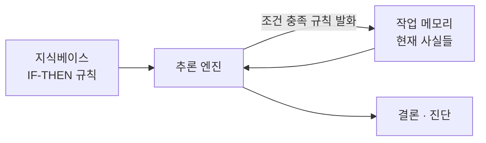

# Rule-base Expert System (규칙기반 전문가 시스템)

> **규칙기반 전문가 시스템은 전문가의 지식을 "만약 ~라면 ~하다(IF-THEN)"라는 규칙 뭉치로 적어 두고, 추론 엔진이 그 규칙을 사실에 맞대어 결론을 이끌어 내는 시스템이다.**

## 전문가의 머릿속 판단을 규칙 목록으로 옮긴 것이다

숙련된 내과 의사는 "열이 나고 기침이 3주 넘게 이어지면 결핵을 의심한다" 같은 경험칙을 수백 개 갖고 있다. **규칙기반 전문가 시스템은 이 경험칙 하나하나를 컴퓨터가 읽을 수 있는 규칙으로 받아 적은 것이다.** 사람 전문가가 자리를 비워도, 규칙에 적힌 판단은 시스템이 대신 반복해 준다.

핵심은 **지식과 처리 로직을 분리**한다는 점이다. 무엇을 아는가(규칙)와 그것을 어떻게 굴리는가(추론 엔진)를 떼어 놓기 때문에, 새 지식은 규칙만 추가하면 되고 프로그램을 다시 짤 필요가 없다.

## 지식베이스와 추론 엔진, 작업 메모리 세 부분으로 돌아간다

시스템은 크게 세 덩어리로 나뉜다.

| 구성 요소 | 역할 |
|-----------|------|
| 지식베이스(Knowledge Base) | `IF 조건 THEN 결론` 형태의 규칙 모음 |
| 작업 메모리(Working Memory) | 지금까지 알려진 사실(fact)들의 현재 상태 |
| 추론 엔진(Inference Engine) | 규칙의 조건을 사실에 맞대어 발화시키고 새 사실을 추가 |

추론 방향은 두 갈래다. 사실에서 출발해 발화 가능한 규칙을 계속 적용하며 결론으로 나아가는 **전방 추론(forward chaining)**, 반대로 증명하고 싶은 목표에서 거꾸로 필요한 조건을 캐 들어가는 [역방향 추론](Backward_Chaining_Inference.md)이 있다.

## 흔한 오해

> ⚠️ **흔한 오해 — "규칙기반 시스템은 데이터로 스스로 학습한다."**
>
> 아니다. 규칙은 사람(지식공학자와 도메인 전문가)이 직접 뽑아 넣는다. 데이터에서 패턴을 학습하는 [머신러닝](Machine_Learning.md)과는 뿌리가 다르다. 규칙기반 시스템은 **기호와 논리로 지식을 다루는 고전 AI**에 속한다.

## 언제 쓰나 / 한계

| 강점 | 한계 |
|------|------|
| 결론에 이른 규칙을 되짚어 **설명이 명확**하다 | 규칙이 수천 개가 되면 **서로 충돌·모순**해 관리가 어렵다 |
| 규칙 단위로 지식을 넣고 빼기 쉽다 | 규칙에 없는 상황은 전혀 다루지 못한다 |
| 규칙이 안정적인 좁은 도메인에서 강하다 | 지식을 사람이 다 캐내야 한다(지식 획득 병목) |

불확실성이 섞인 판단에는 규칙에 [확신도](Certainty_Factor.md)를 붙이거나 [퍼지 논리](Fuzzy_Logic.md)를 얹기도 한다.

## 정리하면

- 규칙기반 전문가 시스템은 전문가 지식을 **IF-THEN 규칙**으로 적어 둔 고전 AI 시스템이다.
- **지식베이스 · 작업 메모리 · 추론 엔진** 세 부분으로 돌아가며, 지식과 로직을 분리한다.
- 결론의 근거를 규칙으로 되짚을 수 있어 **설명 가능성**이 큰 강점이다.
- 규칙이 많아지면 충돌 관리와 지식 획득이 병목이 된다.

## 함께 읽기

- [Expert System](Expert_System.md) — 규칙기반은 전문가 시스템의 가장 대표적인 형태다.
- [Inference Engine](Inference_Engine.md) — 규칙을 사실에 맞대어 발화시키는 심장부.
- [Backward Chaining Inference](Backward_Chaining_Inference.md) — 목표에서 거꾸로 캐 들어가는 추론 방향.
- [Knowledge Engineering](Knowledge_Engineering.md) — 전문가 지식을 규칙으로 캐내 옮기는 작업.
- [Case-Based Reasoning](CaseBased_Reasoning.md) — 규칙 대신 과거 사례로 판단하는 다른 접근.
