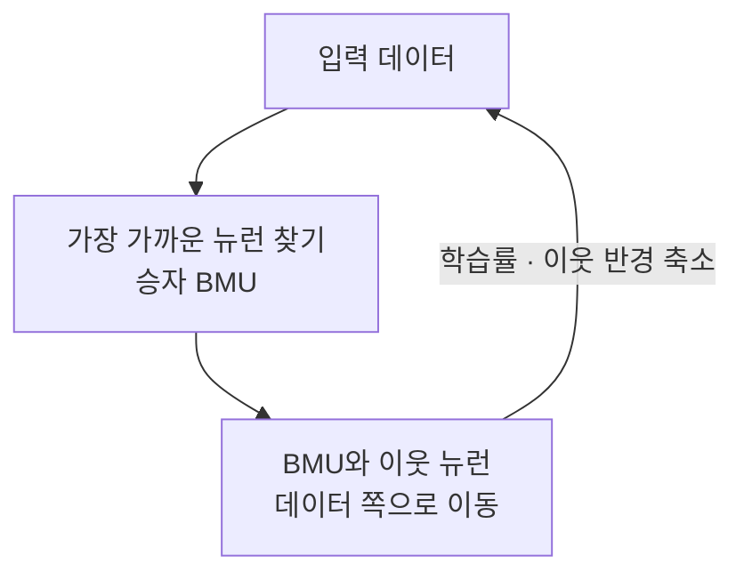

# Self‑Organizing Map (자기조직화 지도)

> **자기조직화 지도(SOM)는 고차원 데이터를 2차원 격자 위에 펼쳐, 비슷한 데이터가 지도상 가까운 자리에 모이도록 배치하는 자율학습 신경망이다.**

## 세계 지도가 나라를 평면에 배치하듯 데이터를 배치한다

지구는 3차원이지만 세계 지도는 그것을 평평한 종이 한 장에 눌러 담는다. 이때 이웃한 나라는 지도에서도 대체로 이웃으로 남는다. **SOM이 데이터에 하는 일이 이것이다.** 수십, 수백 차원의 데이터를 2차원 격자 위에 눌러 담되, **원래 비슷했던 데이터끼리는 지도에서도 가까운 칸에 놓이도록** 스스로 자리를 잡아간다. 이 "이웃 관계를 보존한다"는 점이 [PCA](PCA.md)나 [t-SNE](tSNE.md) 같은 다른 차원 축소와 SOM을 구별 짓는 특징이다.

핀란드의 테우보 코호넨이 1980년대에 제안했으며, 정답 레이블 없이 데이터의 구조만으로 배우는 **자율학습**에 속한다.

## 이긴 뉴런과 그 이웃이 함께 데이터 쪽으로 끌려간다

격자의 각 칸(뉴런)은 입력과 같은 차원의 **가중치 벡터**를 하나씩 들고 있다. 학습은 **경쟁 학습(competitive learning)** 으로 이뤄진다.

1. **초기화:** 격자 뉴런들의 가중치를 (보통 무작위로) 정한다.
2. **입력 제시:** 데이터 하나를 격자 전체에 보여준다.
3. **승자 선정 (BMU):** 그 데이터와 가중치가 가장 가까운 뉴런 하나를 고른다. 이 승자를 **최적 정합 유닛(Best Matching Unit, BMU)** 이라 한다.
4. **가중치 갱신:** BMU의 가중치를 데이터 쪽으로 당긴다. 그리고 **BMU의 이웃 뉴런들도 함께**, 단 멀수록 약하게 당긴다. 이 이웃 갱신이 이웃 관계 보존의 비결이다.
5. **반복:** 학습이 진행될수록 학습률과 이웃 반경을 점점 줄이며 위 과정을 되풀이한다. 처음엔 지도가 크게 출렁이다가 차차 미세 조정으로 넘어간다.

이 과정을 충분히 반복하면, 비슷한 데이터가 격자의 특정 영역에 모여 **군집**을 이루고, 고차원 구조가 2차원 지도로 드러난다.

## 흔한 오해

> ⚠️ **흔한 오해 — "SOM은 레이블을 보고 배우는 지도학습이다."**
>
> 이름의 "지도(map)"는 가르치는 지도(supervision)가 아니라 **지도(地圖, map)** 다. SOM은 정답 없이 데이터 구조만으로 배우는 **자율학습**이다. 번역어가 같아 헷갈리기 쉽다.

## 정리하면

- SOM은 고차원 데이터를 **2차원 격자에 이웃 관계를 보존하며** 펼치는 자율학습 신경망이다.
- **BMU 선정 → BMU와 이웃 가중치 갱신**을 반복하는 경쟁 학습으로 스스로 정렬한다.
- 학습이 진행되며 **학습률과 이웃 반경을 줄여** 큰 배치에서 미세 조정으로 넘어간다.
- 데이터 시각화, 군집화, 이상 탐지, 고객 세분화에 쓰인다.

## 함께 읽기

- [Unsupervised Learning](Unsupervised_Learning.md) — SOM이 속한, 레이블 없는 학습의 큰 틀.
- [Clustering](Clustering.md) — SOM의 대표 용도. 비슷한 데이터를 지도 위에 모은다.
- [Dimensionality Reduction](Dimensionality_Reduction.md) — 고차원을 저차원으로 줄이는 목표를 공유한다.
- [PCA](PCA.md) — 대표적인 선형 차원 축소. SOM과 접근이 다른 짝.
- [Neural Network](Neural_Network.md) — SOM도 뉴런과 가중치로 이뤄진 신경망의 한 종류다.
