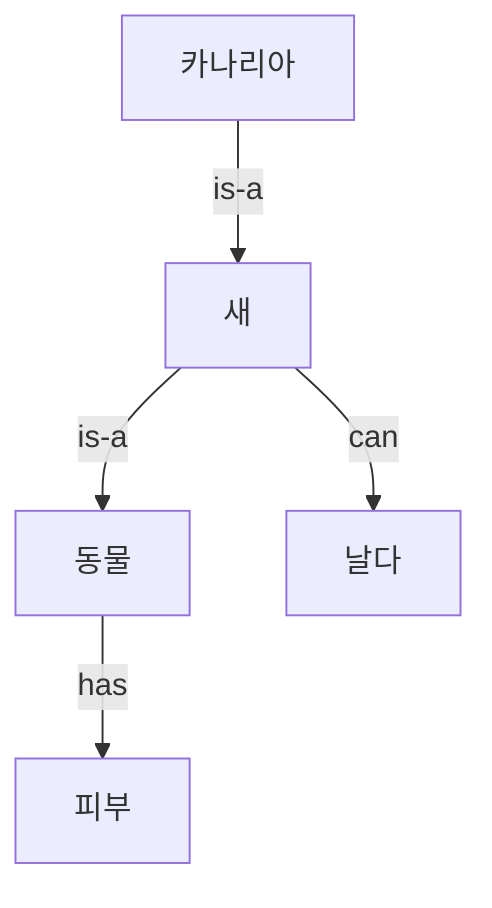

# Semantic Network (의미망)

> **의미망은 개념을 노드로, 개념 사이의 관계를 화살표(엣지)로 그려 지식을 그물망처럼 표현하는 방법이다.**

## 개념들을 선으로 이어 놓은 지식 지도다

머릿속에서 "카나리아는 새다, 새는 날 수 있다, 새는 동물이다"를 떠올릴 때 우리는 개념들을 관계로 잇는다. **의미망은 바로 이 연결 구조를 그림으로 옮긴 것이다.** 각 개념이 점(노드)이고, "~는 ~이다(is-a)", "~를 가진다(has-a)", "~의 일부다(part-of)" 같은 관계가 점을 잇는 선(엣지)이다.

## 상속으로 추론한다 — 위에 붙은 성질을 아래가 물려받는다

의미망의 힘은 **관계를 따라가며 새 사실을 끌어내는 추론**에 있다. 위 그림에서 "카나리아는 날 수 있나?"라고 물으면, 시스템은 `카나리아 --is-a--> 새 --can--> 날다` 경로를 타고 "그렇다"고 답한다. 카나리아에 직접 "날다"를 적어 두지 않아도, **상위 개념의 성질이 하위 개념으로 상속(inheritance)되기 때문**이다.

이 상속 덕에 지식을 간결하게 담는다. "새는 날 수 있다"를 새 아래 모든 종에 일일이 적지 않아도 된다. 다만 "펭귄은 새지만 날지 못한다" 같은 예외는 하위 노드에서 상속을 덮어써야(override) 하고, 이 예외 처리가 의미망의 까다로운 지점이다.

## 흔한 오해

> ⚠️ **흔한 오해 — "의미망은 신경망(neural network)과 같은 것이다."**
>
> 이름이 비슷하지만 전혀 다르다. 의미망은 사람이 이해할 수 있는 개념과 관계를 명시적으로 적어 둔 **기호주의(symbolic) 지식 표현**이고, [신경망](Neural_Network.md)은 숫자 가중치를 학습하는 통계적 모델이다. 의미망의 노드는 "새"라는 개념 그 자체를, 신경망의 노드는 의미 없는 계산 단위를 가리킨다.

## 정리하면

- 의미망은 개념을 노드, 관계를 엣지로 그려 지식을 표현하는 **그래프 기반 방법**이다.
- `is-a`, `part-of` 같은 관계를 따라가며 **상속으로 새 사실을 추론**한다.
- 사람이 읽을 수 있게 지식을 명시적으로 적는 **기호주의 AI**의 대표 기법이다.
- 관계 유형을 엄밀히 정의하고 규모를 키우면 [온톨로지](Ontology.md)와 지식 그래프로 이어진다.

## 함께 읽기

- [Ontology](Ontology.md) — 관계와 개념을 더 엄밀히 형식화한, 의미망의 확장.
- [Semantic Web](Semantic_Web.md) — 의미망 아이디어를 웹 규모로 펼친 것.
- [Knowledge Engineering](Knowledge_Engineering.md) — 이런 지식 표현을 실제로 구축하는 작업.
- [First-order Logic](Firstorder_Logic.md) — 개념과 관계를 논리식으로 엄밀히 다루는 대안.
