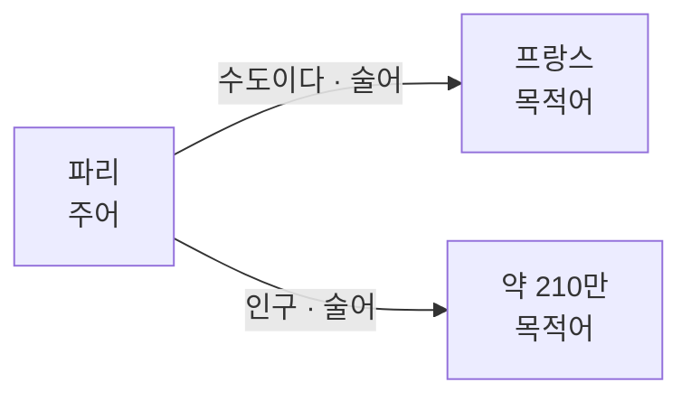

# Semantic Web (의미웹)

> **의미웹은 사람만 읽던 웹의 정보를, 기계도 뜻을 이해하고 연결할 수 있도록 데이터에 명시적 의미를 붙인 웹의 확장이다.**

## 사람이 읽는 웹에서 기계가 읽는 웹으로 넘어가는 것이다

지금의 웹 페이지는 사람 눈에 맞춰져 있다. "파리는 프랑스의 수도다"라는 문장을 사람은 이해하지만, 기계에게는 그냥 글자 나열일 뿐이다. **의미웹은 이 문장을 기계가 "파리 → 수도관계 → 프랑스"라는 사실로 읽게 만드는 것을 목표로 한다.** 웹 창시자 팀 버너스리가 제안한 비전이다.

핵심 단위는 **트리플(triple)**, 즉 `주어–술어–목적어(Subject–Predicate–Object)` 세 쌍이다. 모든 지식을 이 최소 단위로 쪼개 이어 붙이면 거대한 그래프가 된다.

## RDF로 적고, 온톨로지로 뜻을 정의하고, SPARQL로 묻는다

의미웹은 몇 겹의 표준 기술로 쌓인다.

| 기술 | 역할 |
|------|------|
| RDF(Resource Description Framework) | 트리플로 데이터를 적는 표준 모델 |
| URI | 개념·자원마다 전 세계에서 유일한 이름을 부여 |
| [온톨로지](Ontology.md) — RDFS·OWL | "수도"가 무슨 뜻이고 어떤 관계를 갖는지 어휘와 규칙을 정의 |
| SPARQL | RDF 그래프에 질의를 던지는 쿼리 언어 |

URI로 개념에 전역 이름을 주기 때문에, 서로 다른 출처의 데이터도 같은 URI를 가리키면 자동으로 연결된다. 이것이 **링크드 데이터(Linked Data)**의 원리다.

## 흔한 오해

> ⚠️ **흔한 오해 — "의미웹은 완전히 실패했고 지금은 안 쓰인다."**
>
> 초기의 거창한 "웹 전체가 의미화된다"는 비전은 널리 실현되지 못했다. 하지만 그 기술은 살아남았다. Wikidata, Google 지식 그래프, 검색 결과의 리치 스니펫(schema.org 마크업)이 모두 의미웹 계열 기술로 돌아간다. 사라진 게 아니라 **모습을 바꿔 스며들었다.**

## 정리하면

- 의미웹은 데이터에 명시적 의미를 붙여 **기계가 뜻을 읽고 연결하게** 하는 웹의 확장이다.
- 지식을 `주어–술어–목적어` **트리플**로 쪼개 RDF로 적고, 온톨로지로 어휘를 정의하며, SPARQL로 질의한다.
- URI로 개념에 전역 이름을 주어 서로 다른 출처의 데이터를 잇는 것이 **링크드 데이터**다.
- 지식 그래프와 데이터 통합의 기술적 뿌리가 되었다.

## 함께 읽기

- [Ontology](Ontology.md) — 의미웹에서 개념과 관계의 뜻을 정의하는 핵심 층.
- [Semantic Network](Semantic_Network.md) — 트리플 그래프의 개념적 원형.
- [Knowledge Engineering](Knowledge_Engineering.md) — 이런 구조화된 지식을 설계·구축하는 분야.
- [Internet of Things](Internet_of_Things.md) — 기기가 쏟아 내는 데이터를 의미적으로 연결하는 응용.
