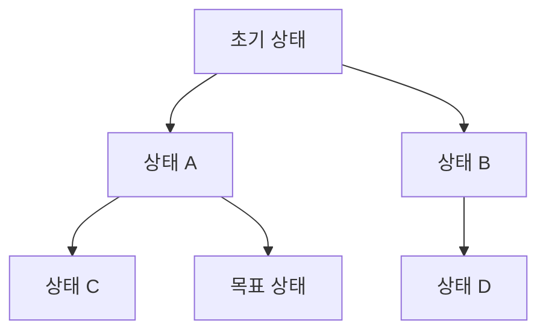

# State Space (상태공간)

> **상태공간은 어떤 문제가 가질 수 있는 모든 상황(상태)과 그 사이를 오가는 행동을 통째로 모아 놓은 것이다. 문제 풀이는 이 공간을 탐색하는 일이 된다.**

## 문제를 "상태들의 지도"로 바꾸는 것이다

미로를 푼다고 하자. 매 순간 "내가 지금 어느 칸에 서 있는가"가 하나의 **상태**이고, "위·아래·좌·우로 한 칸 이동"이 상태를 바꾸는 **행동(operator)**이다. 출발 칸이 초기 상태, 출구 칸이 목표 상태다. **상태공간이란 이렇게 미로의 모든 칸(상태)과 이동(행동)을 한데 모은 지도다.** 문제를 푼다는 것은 초기 상태에서 목표 상태까지 가는 경로를 이 지도에서 찾는 일이 된다.

이렇게 문제를 상태·행동·초기 상태·목표로 정식화하면, 미로든 퍼즐이든 체스든 **같은 틀로 다룰 수 있다.** 8-퍼즐, 루빅스 큐브, 길찾기가 모두 상태공간 탐색 문제다.

## 상태공간은 대개 너무 커서 다 펼칠 수 없다

핵심 난점은 **크기**다. 상태공간은 순식간에 폭발한다. 체스의 가능한 국면은 별의 수보다 많아, 전체를 미리 그려 놓는 것은 불가능하다. 그래서 실제로는 **탐색하면서 필요한 부분만 그때그때 펼친다.**

어떻게 펼칠지가 탐색 알고리즘을 가른다. 얕은 곳부터 훑는 [너비우선 탐색](Breadth_First_Search.md), 한 갈래를 끝까지 파는 [깊이우선 탐색](Depth_First_Search.md), 목표까지의 추정 비용을 [휴리스틱](Heuristic.md)으로 얹어 유망한 쪽부터 보는 [A* 알고리즘](A_Algorithm.md)이 대표적이다. 모두 "같은 상태공간을 어떤 순서로 훑느냐"의 차이다.

> 💡 **참고 — 상태공간은 제어공학에서도 쓰는 말이다.** 거기서는 위치·속도 같은 상태 변수와 미분방정식으로 물리 시스템의 시간 변화를 기술하는 "상태공간 표현"을 가리킨다. AI에서 말하는 탐색용 상태공간과 이름은 같지만 문맥이 다르다.

## 흔한 오해

> ⚠️ **흔한 오해 — "상태공간은 미리 다 만들어 두고 그 위에서 탐색한다."**
>
> 현실적인 문제에서는 상태 수가 천문학적이라 전부 저장할 수 없다. 초기 상태와 "행동을 적용하면 다음 상태가 무엇인지"를 계산하는 규칙만 갖고, **탐색이 진행되는 만큼만 상태를 생성**한다.

## 정리하면

- 상태공간은 문제의 **모든 상태와 그 사이 행동**을 모은 것이고, 문제 풀이는 초기 상태에서 목표까지의 경로 탐색이다.
- 서로 다른 문제도 상태·행동·목표로 정식화하면 **같은 탐색 알고리즘으로** 다룰 수 있다.
- 상태공간은 대개 너무 커서 전부 펼칠 수 없고, **필요한 부분만 그때그때 생성**한다.
- 어떤 순서로 펼치느냐가 BFS·DFS·A* 같은 탐색 전략을 가른다.

## 함께 읽기

- [Problem Solving](Problem_Solving.md) — 문제를 상태공간으로 정식화하는 것이 출발점이다.
- [Breadth First Search](Breadth_First_Search.md) — 상태공간을 얕은 곳부터 훑는 기본 탐색.
- [Depth First Search](Depth_First_Search.md) — 한 갈래를 끝까지 파고드는 탐색.
- [A* Algorithm](A_Algorithm.md) — 휴리스틱으로 유망한 상태부터 펼치는 탐색.
- [Constraint Satisfaction Problem](Constraint_Satisfaction_Problem.md) — 상태를 제약 만족의 관점으로 보는 문제 유형.
