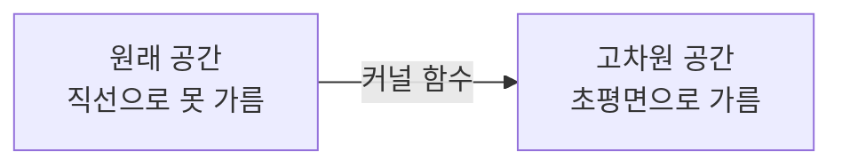

# Support Vector Machine - SVM (서포트 벡터 머신)

> **SVM은 두 범주 사이를 가르는 수많은 경계선 중, 양쪽 데이터와의 여백(마진)이 가장 넓은 경계를 골라 분류하는 지도학습 알고리즘이다.**

## 두 무리 사이에 가장 넓은 길을 내는 것과 같다

운동장에 두 팀이 서 있고, 그 사이에 금을 그어 나눈다고 하자. 금을 그을 방법은 무수히 많지만, 어느 팀에도 너무 붙지 않은 **한가운데 금**이 가장 안전하다. 새 사람이 애매한 위치에 서도 오판할 여지가 적기 때문이다. **SVM이 찾는 경계가 바로 이 한가운데 금이다.** 경계와 가장 가까운 데이터 사이의 거리를 **마진(margin)** 이라 하고, SVM은 이 마진이 **최대가 되는** 경계(초평면)를 고른다.

이때 경계를 실제로 떠받치는 건 양쪽 가장자리에 놓인 소수의 데이터점뿐이다. 이들을 **서포트 벡터(support vector)** 라 부른다. 나머지 점들은 아무리 많아도 경계 위치에 영향을 주지 않는다. 경계가 몇 개의 결정적 점에만 기대므로 SVM은 잡음에 비교적 강하다.

## 커널로 휘어서 직선으로 못 가르는 데이터를 가른다

문제는 현실 데이터가 직선 하나로 안 나뉘는 경우다. SVM의 두 번째 무기가 여기서 나온다.

- **마진 최대화:** 마진이 가장 넓은 초평면을 찾는 최적화 문제를 푼다. 마진이 넓을수록 일반화 성능이 좋다는 것이 이론적 근거다.
- **소프트 마진:** 완벽히 안 나뉘는 데이터에서는 약간의 오분류를 허용하되, 그 대가에 벌점을 매긴다. 허용 정도는 `C`라는 값으로 조절한다.
- **커널 트릭(kernel trick):** 데이터가 저차원에서 뒤엉켜 있으면, 더 높은 차원으로 끌어올려 그곳에서 직선(초평면)으로 가른다. 놀라운 점은 실제로 고차원 좌표를 계산하지 않고 **커널 함수**로 그 효과만 얻는다는 것이다. RBF(가우시안), 다항식 커널 등이 대표적이다.

## 흔한 오해

> ⚠️ **흔한 오해 — "SVM은 모든 데이터점을 다 봐서 경계를 정한다."**
>
> 경계를 정하는 건 가장자리의 **서포트 벡터 몇 개뿐**이다. 경계에서 멀리 떨어진 점은 위치를 바꾸든 지우든 경계에 영향을 주지 않는다. 그래서 모델을 저장할 때도 서포트 벡터만 남기면 된다.

## 정리하면

- SVM은 두 범주 사이 **마진이 가장 넓은 초평면**을 찾아 분류한다.
- 경계를 떠받치는 소수의 가장자리 점이 **서포트 벡터**이며, 이들만이 경계를 결정한다.
- 직선으로 못 가르는 데이터는 **커널 트릭**으로 고차원에 올려 가른다.
- 고차원·소규모 데이터에서 강하지만, 데이터가 아주 크면 학습이 느려진다.

## 함께 읽기

- [Supervised Learning](Supervised_Learning.md) — SVM이 속한 지도학습의 큰 틀.
- [K-Nearest Neighbor Classification](KNearest_Neighbor_Classification.md) — 같은 분류 문제를 거리 기반으로 푸는 다른 접근.
- [Perceptron](Perceptron.md) — 선형 경계로 나눈다는 발상을 공유하는 더 단순한 모델.
- [Optimization](Optimization.md) — 마진 최대화는 결국 하나의 최적화 문제다.
