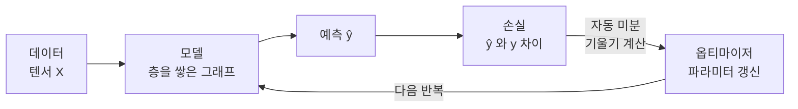

# TensorFlow (텐서플로)

> **TensorFlow는 구글이 만든 오픈소스 딥러닝 프레임워크로, 신경망을 정의하고 자동 미분으로 학습시키는 일을 대신 해 준다.**

## 딥러닝을 위한 계산 공장이다

신경망을 직접 짜려면 수백만 개의 곱셈과 덧셈, 그리고 그 모든 값에 대한 미분을 손으로 관리해야 한다. **TensorFlow는 이 계산을 대신 돌리는 공장이다.** 우리는 "이런 층을 쌓겠다"는 설계도만 그리고, 데이터를 흘려보내는 순전파와 기울기를 되돌리는 [역전파](Backpropagation.md)는 공장이 알아서 처리한다.

이름의 두 조각이 핵심을 말해 준다.

- **Tensor(텐서)** — 데이터를 담는 다차원 배열이다. 스칼라(0차원), 벡터(1차원), 행렬(2차원), 그 이상(n차원)까지 모두 텐서다. 이미지 한 장은 `높이 × 너비 × 채널`짜리 텐서다.
- **Flow(흐름)** — 그 텐서들이 연산의 그래프를 따라 흘러가며 변환된다.

## 자동 미분이 학습을 가능하게 한다

신경망 학습은 결국 **[손실 함수](Loss_Function.md)를 줄이는 방향으로 파라미터를 조금씩 고치는 일**이다. 그 "방향"을 알려면 각 파라미터가 손실에 얼마나 영향을 주는지, 즉 기울기(gradient)를 알아야 한다. TensorFlow의 `GradientTape`는 순전파 중의 연산을 기록해 두었다가 이 기울기를 자동으로 계산한다. 사람이 미분 공식을 유도할 필요가 없다.



실무에서는 대개 이 과정을 감싼 고수준 API [Keras](Keras.md)로 짧게 쓴다. `Sequential`로 층을 쌓고, `compile`로 옵티마이저·손실을 지정하고, `fit`으로 학습한다.

```python
import tensorflow as tf

# 손글씨 숫자(MNIST) 분류 예시
(x_train, y_train), (x_test, y_test) = tf.keras.datasets.mnist.load_data()
x_train, x_test = x_train / 255.0, x_test / 255.0  # 0~1로 정규화

model = tf.keras.Sequential([
    tf.keras.layers.Flatten(input_shape=(28, 28)),
    tf.keras.layers.Dense(128, activation="relu"),
    tf.keras.layers.Dense(10, activation="softmax"),
])

model.compile(optimizer="adam",
              loss="sparse_categorical_crossentropy",
              metrics=["accuracy"])

model.fit(x_train, y_train, epochs=5, batch_size=32)
model.evaluate(x_test, y_test)
```

## 흔한 오해

> ⚠️ **흔한 오해 — "TensorFlow는 옛날처럼 그래프를 먼저 다 정의해야 한다."**
>
> 초기 TensorFlow 1.x는 그래프를 미리 만들고 세션을 열어 실행하는 방식이라 낯설고 디버깅이 어려웠다. 하지만 **TensorFlow 2.x부터는 파이썬 코드가 실행되는 즉시 계산되는 즉시 실행(eager execution)이 기본**이다. 지금은 PyTorch만큼이나 직관적으로 쓴다.

> 💡 **참고 — TensorFlow와 Keras의 관계**
>
> Keras는 원래 별도 라이브러리였지만 지금은 TensorFlow에 `tf.keras`로 통합되어 있다. TensorFlow가 계산 엔진이라면 Keras는 그 위에 얹힌 편한 조립 인터페이스다.

## 정리하면

- TensorFlow는 신경망의 계산과 [역전파](Backpropagation.md)를 대신 처리하는 딥러닝 프레임워크다.
- 모든 데이터는 다차원 배열인 **텐서**로 표현되고, 연산 그래프를 따라 흐른다.
- **자동 미분**으로 기울기를 계산해 [경사 하강법](Gradient_Descent.md) 계열 옵티마이저가 파라미터를 갱신한다.
- 실무에서는 고수준 API [Keras](Keras.md)로 층을 쌓아 간결하게 쓴다.
- 라이벌 [PyTorch](PyTorch.md)와 함께 딥러닝의 양대 프레임워크다.

## 함께 읽기

- [Keras](Keras.md) — TensorFlow 위에서 신경망을 쉽게 조립하는 고수준 API.
- [PyTorch](PyTorch.md) — TensorFlow와 경쟁하는 또 하나의 대표 딥러닝 프레임워크.
- [Neural Network](Neural_Network.md) — TensorFlow가 만들고 학습시키는 대상.
- [Backpropagation](Backpropagation.md) — 자동 미분이 대신 계산해 주는 학습의 핵심 알고리즘.
- [Scikit-learn](Scikitlearn.md) — 딥러닝이 아닌 고전 머신러닝을 담당하는 짝.
