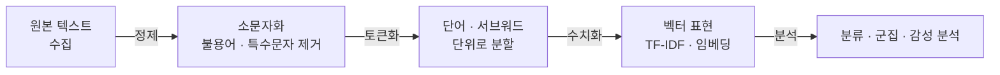

# Text Mining (텍스트마이닝)

> **텍스트 마이닝은 정형화되지 않은 대량의 글에서 유용한 패턴과 정보를 자동으로 뽑아내는 작업이다.**

## 산더미 같은 문서에서 사금을 걸러내기

고객 리뷰 수십만 건, 뉴스 기사 수년치를 사람이 다 읽을 수는 없다. **텍스트 마이닝은 이 글더미를 강물처럼 흘려보내며 의미 있는 사금(패턴·감정·주제)을 걸러내는 일이다.** 숫자 표를 다루는 [데이터 마이닝](Data_Mining.md)과 목표는 같지만, 상대가 문법과 맥락과 중의성으로 얽힌 **자연어**라는 점이 다르다.

바로 그 때문에 텍스트 마이닝은 컴퓨터가 사람 언어를 다루는 분야인 자연어 처리(NLP)의 기법에 크게 기댄다. 글은 그대로 계산할 수 없으니, 먼저 컴퓨터가 다룰 수 있는 형태로 바꾸는 과정이 반드시 앞선다.

## 정제 → 토큰화 → 수치화 → 분석 순으로 흐른다

텍스트 마이닝은 대체로 이런 파이프라인을 따른다.

- **정제**: 특수문자·군더더기를 걷어내고 형태를 통일한다([데이터 전처리](Data_Preprocessing.md)의 텍스트판).
- **[토큰화](Tokenization.md)**: 글을 단어·서브워드 같은 처리 단위로 쪼갠다.
- **수치화**: 토큰을 숫자로 바꾼다. 단어 빈도 기반의 TF-IDF나, 의미를 벡터로 담는 [단어 임베딩](Word_Embedding.md)을 쓴다.
- **분석**: 수치화된 텍스트에 [머신러닝](Machine_Learning.md)이나 통계 기법을 적용해 감성 분석, 주제 군집, 문서 분류 등을 수행한다.

## 흔한 오해

> ⚠️ **흔한 오해 — "단어만 세면 텍스트의 의미를 파악할 수 있다."**
>
> 단순 빈도 계산은 "이 영화는 지루하지 않다"의 부정을 놓치고, "은행(bank)"이 강둑인지 금융기관인지 구별하지 못한다. 순서·맥락·중의성 때문에 단어 빈도만으로는 의미에 한계가 있고, 그래서 임베딩과 문맥 모델이 필요하다.

## 정리하면

- 텍스트 마이닝은 비정형 글더미에서 패턴·정보를 자동으로 뽑아내는 일이다.
- 자연어의 문법·맥락·중의성 때문에 NLP 기법에 크게 기댄다.
- 정제 → 토큰화 → 수치화 → 분석의 파이프라인을 따른다.
- 단어 빈도만으로는 의미에 한계가 있어 임베딩·문맥 정보가 필요하다.

## 함께 읽기

- [Data Mining](Data_Mining.md) — 텍스트 마이닝의 정형 데이터 버전. 목표는 같다.
- [Tokenization](Tokenization.md) — 글을 처리 단위로 쪼개는 첫 관문.
- [Word Embedding](Word_Embedding.md) — 단어의 의미를 벡터로 담아 수치화한다.
- [Machine Learning](Machine_Learning.md) — 수치화된 텍스트에서 패턴을 찾는 엔진.
