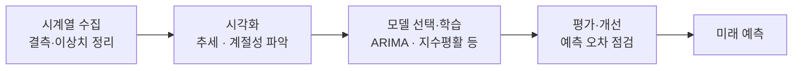

# Time Series Analysis (시계열분석)

> **시계열 분석은 시간 순서대로 쌓인 데이터에서 패턴을 읽어 내고 미래 값을 예측하는 기법이다.**

## 순서가 곧 정보인 데이터를 다룬다

보통의 데이터는 행 순서를 뒤섞어도 상관없다. 하지만 주가, 기온, 매출 같은 데이터는 다르다. **어제 다음이 오늘이라는 순서 자체가 정보다.** 시계열 분석은 이 순서를 무너뜨리지 않고, "지금까지 이렇게 흘러왔으니 다음은 이럴 것이다"를 읽어 낸다.

시계열을 이해하는 첫걸음은 하나의 곡선을 세 성분으로 분해해 보는 것이다.

| 성분 | 뜻 | 예 |
|------|-----|-----|
| 추세(Trend) | 장기적으로 오르거나 내리는 큰 흐름 | 해마다 늘어나는 전력 사용량 |
| 계절성(Seasonality) | 일정 주기로 반복되는 패턴 | 매년 여름마다 뛰는 아이스크림 판매 |
| 노이즈(Noise) | 규칙으로 설명 안 되는 무작위 변동 | 그날그날의 우연한 출렁임 |

여기에 **자기상관(autocorrelation)** 이 더해진다. 오늘 값이 어제·그제 값과 얼마나 닮았는지를 재는 것으로, 시계열 예측이 성립하는 근거다. 과거가 미래와 무관하다면 예측할 것도 없다.

## 과거 패턴에서 미래를 세운다



대표적인 고전 모델이 **ARIMA**다. 세 조각의 결합인데, 자기회귀(AR)는 과거 값들로 현재를 설명하고, 차분(I)은 추세를 걷어 내 안정적인 형태로 만들며, 이동평균(MA)은 과거 예측 오차를 반영한다. 계절성이 뚜렷하면 이를 확장한 SARIMA를, 추세·계절성을 부드럽게 좇으려면 지수평활(Exponential Smoothing) 계열을 쓴다. 최근에는 순서를 기억하는 [RNN](Recurrent_Neural_Network___RNN.md)·[LSTM](Long_ShortTerm_Memory___LSTM.md) 같은 딥러닝 모델도 널리 쓴다.

```python
import pandas as pd
from statsmodels.tsa.arima.model import ARIMA

# 월별 매출 시계열 (DatetimeIndex를 가진 Series)
series = pd.read_csv("sales.csv", index_col="date", parse_dates=True)["sales"]

model = ARIMA(series, order=(1, 1, 1))  # (p, d, q)
fit = model.fit()
print(fit.forecast(steps=3))            # 다음 3개월 예측
```

## 흔한 오해

> ⚠️ **흔한 오해 — "데이터를 무작위로 섞어 학습/테스트를 나누면 된다."**
>
> 시계열에서는 절대 안 된다. 무작위로 섞으면 **미래 데이터로 과거를 예측하는 셈**이 되어, 실제로는 알 수 없는 정보가 학습에 새어 든다. 시계열은 반드시 **시간 경계로** 나눠, 과거로 학습하고 그 이후 구간으로 검증해야 한다.

> 💡 **참고 — 정상성(stationarity)**
>
> 많은 고전 시계열 모델은 통계적 성질(평균·분산)이 시간에 따라 크게 변하지 않는 정상 시계열을 전제한다. 추세나 계절성이 있으면 차분·변환으로 먼저 정상성에 가깝게 만든 뒤 모델을 적용한다.

## 정리하면

- 시계열 분석은 **순서가 정보인 데이터**를 다뤄 미래를 예측한다.
- 곡선을 추세·계절성·노이즈로 분해하고, 자기상관을 예측의 근거로 삼는다.
- 고전 모델로는 ARIMA·지수평활, 최근에는 [RNN](Recurrent_Neural_Network___RNN.md)·[LSTM](Long_ShortTerm_Memory___LSTM.md)을 쓴다.
- 데이터 분할은 무작위가 아니라 **시간 순서대로** 해야 미래 정보 누수를 막는다.

## 함께 읽기

- [Recurrent Neural Network - RNN](Recurrent_Neural_Network___RNN.md) — 순서 있는 데이터를 다루는 신경망, 시계열 예측의 딥러닝 축.
- [Long Short-Term Memory - LSTM](Long_ShortTerm_Memory___LSTM.md) — 긴 시계열의 장기 의존성을 기억하는 RNN 개선판.
- [Kalman Filter](Kalman_Filter.md) — 시간에 따라 변하는 상태를 순차적으로 추정하는 고전 기법.
- [Concept Drift](Concept_Drift.md) — 시간이 지나며 데이터의 패턴 자체가 변해 예측이 흔들리는 문제.
- [Machine Learning](Machine_Learning.md) — 시계열 예측을 포함하는 더 넓은 학습의 틀.
