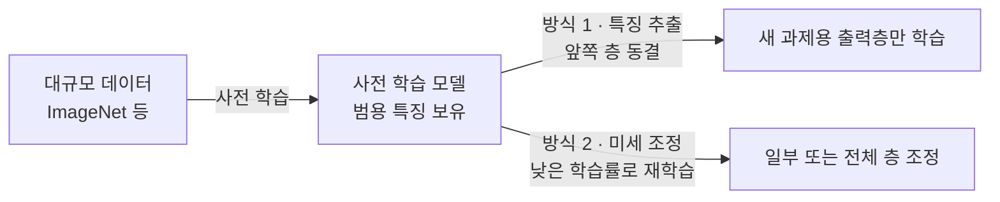

# Transfer Learning (전이 학습)

> **전이 학습은 한 과제에서 이미 배운 모델의 지식을 가져와 다른 과제에 재사용하는 기법이다.** 처음부터 새로 배우는 대신, 남이 쌓아 둔 실력 위에서 시작한다.

## 피아노를 배운 사람이 오르간을 빨리 익히는 것과 같다

건반, 화음, 박자를 이미 아는 피아니스트는 오르간 앞에 앉아도 백지에서 시작하지 않는다. 공통된 음악 감각은 그대로 쓰고, 오르간 특유의 발건반과 음색만 새로 익히면 된다. **전이 학습이 딱 이것이다.** 대규모 데이터로 미리 학습한 모델(pre-trained model)이 쌓아 둔 일반적 특징을, 새 과제에 옮겨 붙인다.

이게 강력한 이유는 앞쪽 층일수록 **범용적인 특징**을 배우기 때문이다. 이미지 모델의 초기 층은 모서리·색·질감처럼 어떤 이미지에서든 통하는 것을 배우고, 뒤쪽 층으로 갈수록 "고양이 귀" 같은 과제 고유의 특징으로 특화된다. 그러니 앞쪽은 재사용하고 뒤쪽만 바꾸면 된다.

## 특징 추출과 미세 조정, 두 가지 방식이 있다

| 방식 | 무엇을 하나 | 언제 쓰나 |
|------|-----------|----------|
| 특징 추출 (feature extraction) | 사전 학습 층을 **동결**하고 새 출력층만 학습 | 데이터가 적고, 새 과제가 원래 과제와 비슷할 때 |
| 미세 조정 ([Fine-tuning](Fine_Tuning.md)) | 사전 학습 층을 **낮은 학습률**로 함께 재학습 | 데이터가 어느 정도 있고, 과제가 다소 다를 때 |

미세 조정에서 학습률을 낮게 잡는 이유는, 기존 지식을 급격히 덮어쓰지 않고 조심스럽게 다듬기 위해서다.

## 흔한 오해

> ⚠️ **흔한 오해 — "전이 학습은 항상 성능을 올려 준다."**
>
> 원래 과제와 새 과제가 너무 다르면 오히려 방해가 된다. 이를 **부정적 전이(negative transfer)**라 한다. 예를 들어 자연 사진으로 배운 특징이 의료 X-ray처럼 성질이 완전히 다른 데이터에는 잘 맞지 않을 수 있다.

> 💡 **참고 — 데이터·연산이 부족할 때 특히 빛난다.**
> 밑바닥부터 학습하려면 방대한 데이터와 GPU 시간이 필요하다. 전이 학습은 남이 그 비용을 이미 치른 모델을 재활용하므로, 데이터가 수백~수천 장뿐인 현실적 상황에서 사실상 표준 전략이다.

## 정리하면

- 전이 학습은 사전 학습 모델의 지식을 **새 과제에 재사용**하는 기법이다.
- 앞쪽 층의 **범용 특징**은 재사용하고, 뒤쪽·출력층만 새 과제에 맞춘다.
- **특징 추출**(층 동결)과 **미세 조정**(낮은 학습률 재학습) 두 방식이 있다.
- 데이터·연산이 부족할 때 강력하지만, 과제가 너무 다르면 부정적 전이를 조심해야 한다.

## 함께 읽기

- [Fine-tuning](Fine_Tuning.md) — 전이 학습의 핵심 방식 중 하나를 더 깊이.
- [Foundation Model](Foundation_Model.md) — 오늘날 전이의 출발점이 되는 대규모 사전 학습 모델.
- [Knowledge Distillation](Knowledge_Distillation.md) — 지식을 옮긴다는 점에서 닮은, 큰 모델→작은 모델 압축 기법.
- [Deep Learning](Deep_Learning.md) — 층별 특징 학습이 전이의 토대.
