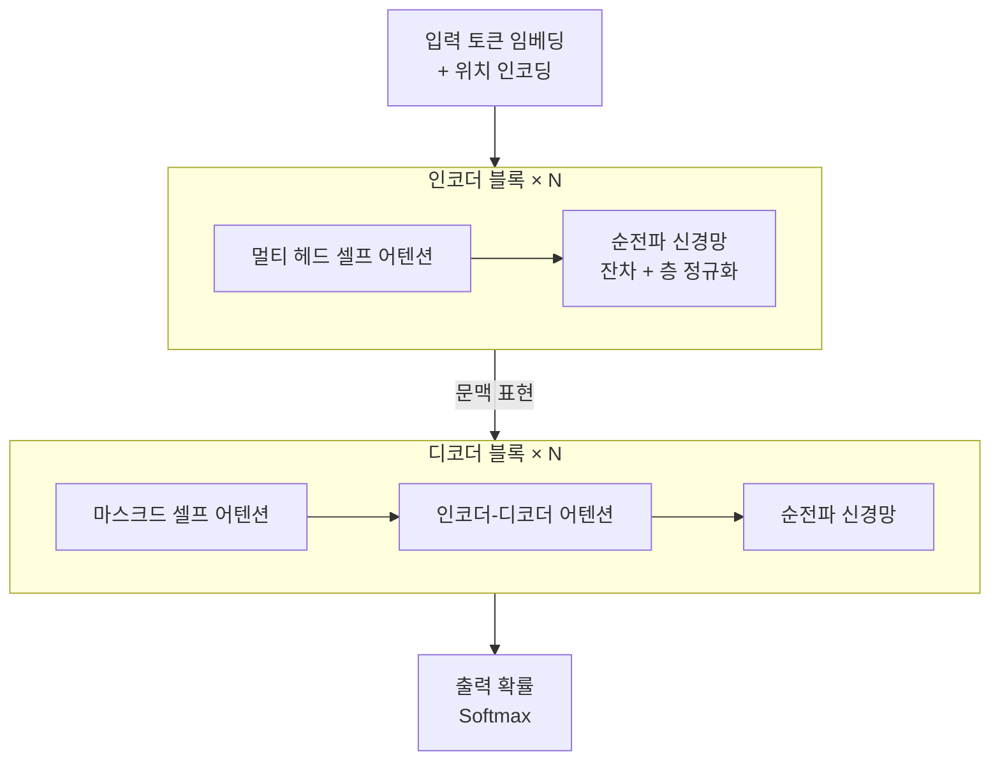

# Transformer (트랜스포머)

> **트랜스포머는 순환도 합성곱도 없이, 오직 어텐션만으로 시퀀스 전체의 관계를 한 번에 계산하는 신경망 아키텍처다.** 2017년 "Attention Is All You Need" 논문에서 나왔고, 오늘날 거의 모든 [대규모 언어 모델](Large_Language_Model___LLM.md)의 뼈대다.

## 한 줄 귓속말 대신, 모두가 동시에 서로를 본다

[RNN](Recurrent_Neural_Network___RNN.md)은 문장을 한 단어씩 순서대로 읽으며 정보를 뒤로 전달한다. 마치 한 줄로 서서 귓속말을 옆으로 넘기는 것과 같다. 문장이 길면 앞쪽 정보가 뒤로 갈수록 희미해지고, 순서대로 처리해야 하니 병렬화도 안 된다.

트랜스포머는 이 줄서기를 없앴다. **모든 단어가 회의 테이블에 둘러앉아 동시에 서로를 바라보고, 서로 얼마나 관련 있는지를 직접 계산한다.** 이것이 [셀프 어텐션](SelfAttention.md)이다. "그 동물이 길을 못 건넌 이유는 너무 피곤했기 때문이다"에서 "그것"이 동물을 가리키는지 길을 가리키는지를, 거리에 상관없이 한 번에 판단한다.

## 인코더와 디코더 블록을 쌓아 만든다

트랜스포머는 같은 구조의 블록을 여러 층 쌓아 만든다. 각 블록의 핵심은 [멀티 헤드 어텐션](MultiHead_Attention.md)과 위치별 순전파 신경망이며, 각 하위 층은 잔차 연결(residual)과 층 정규화로 감싼다.

- **위치 인코딩(positional encoding)**: 셀프 어텐션은 순서를 구분하지 못하므로, 각 토큰에 위치 정보를 더해 준다.
- **멀티 헤드 어텐션**: 여러 개의 어텐션을 병렬로 두어, 서로 다른 종류의 관계(문법·의미 등)를 동시에 포착한다.
- **인코더**는 입력 전체를 이해해 문맥 표현을 만들고, **디코더**는 그 표현을 참고하며 출력을 한 토큰씩 생성한다.

BERT는 인코더만, GPT는 디코더만 떼어 쓰는 식으로 변형된다.

## 흔한 오해

> ⚠️ **흔한 오해 — "트랜스포머는 곧 ChatGPT/GPT다."**
>
> 트랜스포머는 **아키텍처(설계도)**이고, [GPT](GPT.md)·[BERT](BERT.md)는 그 설계도로 지은 **모델**이다. 게다가 트랜스포머는 언어 전용도 아니다. 이미지(ViT), 음성, 단백질 구조 예측 등 여러 분야에 쓰인다.

> 💡 **참고 — 순서를 "저절로" 아는 게 아니다.**
> 셀프 어텐션은 단어를 집합처럼 다뤄 순서를 바꿔도 결과가 같다(순열 불변). 그래서 위치 인코딩을 명시적으로 더하지 않으면 "개가 사람을 물었다"와 "사람이 개를 물었다"를 구분하지 못한다.

## 정리하면

- 트랜스포머는 순환·합성곱을 버리고 **어텐션만으로** 시퀀스 관계를 한 번에 계산한다.
- 덕분에 **병렬 처리**가 가능하고 **긴 거리 의존성**을 잘 잡는다.
- 인코더·디코더 블록을 쌓고, 셀프 어텐션·멀티 헤드·위치 인코딩·잔차 연결로 이뤄진다.
- BERT·GPT를 비롯한 현대 LLM과 파운데이션 모델의 공통 뼈대다.

## 함께 읽기

- [Self-Attention](SelfAttention.md) — 트랜스포머 심장부의 핵심 연산.
- [Multi-Head Attention](MultiHead_Attention.md) — 여러 관계를 동시에 보는 어텐션 확장.
- [Attention](Attention.md) — 트랜스포머를 떠받치는 어텐션의 일반 개념.
- [GPT](GPT.md) / [BERT](BERT.md) — 트랜스포머로 지은 대표 모델들.
- [Recurrent Neural Network - RNN](Recurrent_Neural_Network___RNN.md) — 트랜스포머가 극복한 순차 처리 방식.
