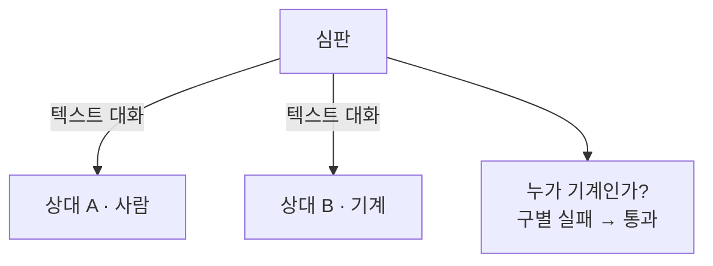

# Turing Test (튜링 테스트)

> **튜링 테스트는 기계가 지능을 가졌는지 묻는 대신, "대화만으로 사람인지 기계인지 구별할 수 없다면 지능이 있다고 치자"고 제안한 판정 방식이다.**

## "지능이란 무엇인가"를 "구별할 수 있는가"로 바꿔치기한 것이다

"기계가 생각할 수 있는가?"는 답하기 어렵다. 생각이 뭔지부터 합의가 안 되기 때문이다. 앨런 튜링은 1950년 논문에서 이 난제를 영리하게 우회했다. **속을 들여다보는 대신, 겉으로 드러나는 행동만 보자는 것이다.** 튜링은 이를 "모방 게임(imitation game)"이라 불렀다.

방식은 이렇다. 심판이 벽 너머 두 상대와 **오직 텍스트로만** 대화한다. 한쪽은 사람, 다른 쪽은 기계다. 대화를 마친 심판이 누가 기계인지 안정적으로 가려내지 못하면, 그 기계는 테스트를 통과한 것이다.

## 지능의 정의가 아니라 조작적 판정 기준이다

튜링 테스트가 재는 것은 **대화에서 사람과 구별되지 않는 정도**이지, 내부에 진짜 이해나 의식이 있는지가 아니다. 이 점을 겨눈 유명한 반론이 존 설(John Searle)의 **중국어 방(Chinese Room)** 논증이다. 규칙표만 보고 중국어 답을 내놓는 사람은 중국어를 "이해"하지 않고도 대화를 통과할 수 있으니, 통과가 곧 이해는 아니라는 주장이다.

> ⚠️ **흔한 오해 — "튜링 테스트를 통과하면 그 기계는 진짜로 생각하고 의식이 있는 것이다."**
>
> 튜링 테스트는 **겉으로 드러난 대화 능력**만 잰다. 통과는 "사람과 구별하기 어렵다"는 뜻이지, 내부에 이해·감정·의식이 있다는 증거가 아니다. 이미 1966년 단순 규칙 챗봇 ELIZA가 사람들을 상당히 속였는데, ELIZA가 무언가를 이해했다고 보기는 어렵다. 오늘날 [대규모 언어 모델](Large_Language_Model___LLM.md)이 유창하게 대화하지만, 그럴듯한 거짓을 지어내는 [환각](Hallucination.md)에서 보듯 유창함과 이해는 별개다.

## 정리하면

- 튜링 테스트는 지능을 정의하는 대신 **"대화로 사람과 구별 안 되면 지능으로 치자"**는 조작적 판정이다.
- 심판이 텍스트 대화만으로 사람과 기계를 가려내지 못하면 통과다.
- 재는 것은 **겉으로 드러난 대화 능력**이지 내부의 이해·의식이 아니며, 중국어 방 논증이 이 간극을 지적한다.
- 유창한 대화가 곧 진짜 이해는 아니라는 점은 ELIZA와 오늘날 LLM 모두에서 확인된다.

## 함께 읽기

- [Turing Machine](Turing_Machine.md) — 같은 앨런 튜링이 만든, 계산을 정의하는 별개의 개념.
- [Large Language Model - LLM](Large_Language_Model___LLM.md) — 사람 같은 대화로 이 논의를 다시 뜨겁게 만든 기술.
- [Hallucination](Hallucination.md) — 유창함과 진짜 이해가 어긋나는 대표적 현상.
- [Intelligent Agent](Intelligent_Agent.md) — 지능을 행동으로 규정하려는 또 다른 관점.
